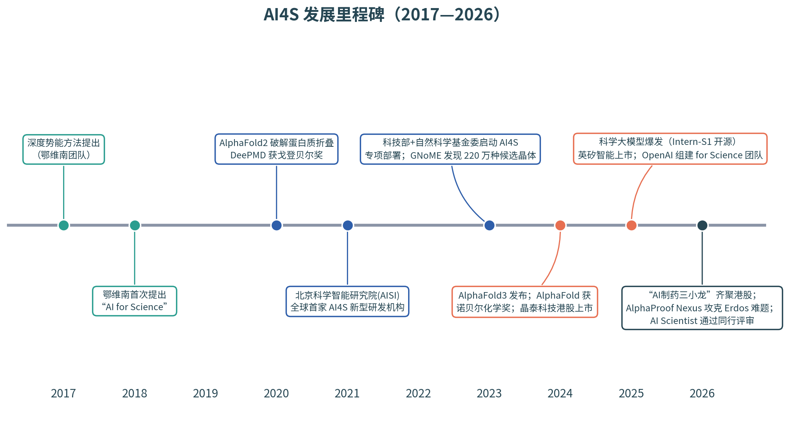
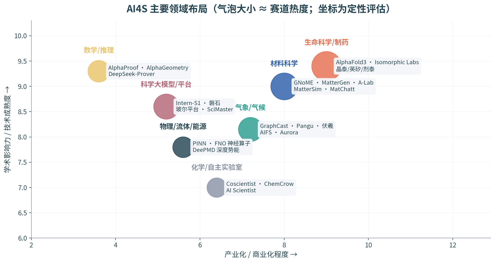
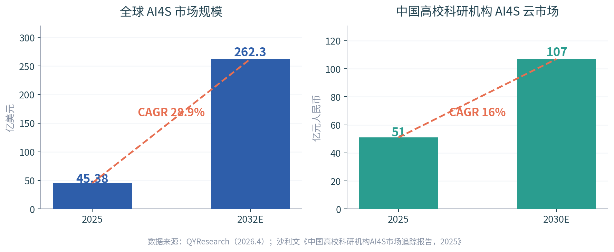
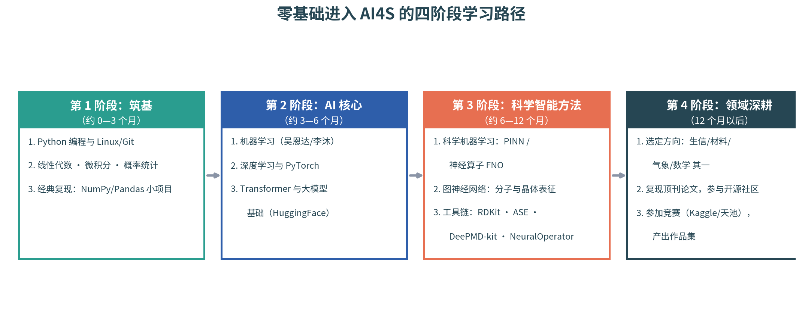

# AI4S（AI for Science）全方位调研报告

> **调研时间**：2026 年 10 月 ｜ **面向读者**：计划进入 AI4S 领域、目前零基础或基础较弱的从业者
> **调研范围**：概念与范式、技术脉络、六大主流方向、全球格局与政策、产业与市场、人才需求、零基础入行路径

---

## 摘要（TL;DR）

**AI4S（AI for Science，人工智能驱动的科学研究）** 被公认为继实验、理论、计算、数据之后的**"第五科研范式"**：用 AI 从海量科学数据中发现规律、预测现象、设计实验，直至自主完成"假设—验证"闭环。该概念由中国科学院院士**鄂维南于 2018 年首次提出**，2023 年中国科技部联合自然科学基金委启动专项部署，2024 年 AlphaFold 获诺贝尔化学奖成为标志性事件，目前全球市场规模约 45 亿美元并以约 29% 的年复合增速扩张。对零基础者而言，进入路径清晰可行：**先用 6 个月打好"Python + 数学 + 机器学习/深度学习"地基，再用 6 个月掌握科学机器学习（PINN、神经算子、图神经网络）与开源工具链，最后选定一个应用领域深耕并产出作品集**。当前市场最稀缺的是"懂 AI 又懂科学"的交叉人才，高性能计算工程师供需比低至 0.15，是进入的黄金窗口期。

---

## 一、什么是 AI4S：定义与范式变革

### 1.1 定义与核心内涵

AI4S（AI for Science，又称"科学智能"）是指**利用人工智能技术和方法加速科学研究和发现的过程**：通过数据驱动的科学发现挖掘海量数据中的模式与规律，通过自动化与智能化实验设计优化实验方案，通过模型预测与仿真结合物理模型与数据驱动模型进行复杂现象预测，并通过预训练大模型、科学知识图谱等手段系统性提升科研效率。它被广泛认为是继实验科学、理论科学、计算科学、数据科学之后的**"第五科研范式"**，核心目标是推动科研从依赖经验试错的"作坊式"向高效智能的**"平台科研"**模式转变，实现 AI 从"辅助计算"到"自主发现"的角色跃迁[^6^][^2^]。

从角色演进看，AI 在科研中的地位正经历质变：传统范式下 AI 只是提升效率的工具（数据分析、模拟加速），而在智能科学范式下，AI 将主导科学发现全流程——在无需人类输入创造性劳动的条件下，通过智能体协作自主完成"提出构想、设计实验、形成假设、执行证伪"的闭环[^1^]。学界将这一过程概括为三个阶段：**AI Assistant（数据分析工具）→ AI Scientist（深度参与科研过程）→ AI Innovator（接近 AGI 能力的科学创新者）**[^6^]。清华大学智能产业研究院进一步提出，AI 的核心突破点在于"**AI 自主证伪能力**"，这是确保科学发现有效性的关键，标志着 AI 从"助手"向"发现主体"的转变[^1^]。

AI4S 要解决的是科学研究中长期存在的**四大痛点**：基础研究成果难以解决实际问题、实验与数据处理效率低下、科研团队"小农作坊"式的工作方式、以及生物制药材料等领域仍依赖经验试错[^7^]。2026 年 8 月召开的科学智能大会上，鄂维南院士提出 AI4S 已进入"**下半场**"——重心从人工智能方法探索，转向人工智能时代科研体系的系统性变革，包括平台化科研、"干湿闭环"（计算与实验闭环）、科研平权化等方向[^4^]。

### 1.2 发展历程与关键里程碑

AI4S 的源头可以追溯到 2017 年：鄂维南课题组在用深度学习辅助分子动力学模拟时获得 5—6 个数量级的加速，据此提出**深度势能（Deep Potential）**方法，用深度神经网络计算上亿原子间的相互作用势能，由此发展出 DeePMD-kit 开源软件与 DeepModeling 开源社区，并在 2020 年获得高性能计算领域最高奖"戈登·贝尔奖"[^56^][^57^]。2018 年鄂维南正式提出"AI for Science"概念，同年 DeepMind 的 AlphaFold1 将深度学习应用于蛋白质折叠问题[^6^]。随后 2020 年 AlphaFold2 以接近实验精度破解蛋白质结构预测、2021 年全球首家以 AI4S 命名的新型研发机构——北京科学智能研究院（AISI）成立、2023 年科技部联合自然科学基金委启动 AI4S 专项部署，领域进入快车道[^7^][^3^]。

2024—2026 年是 AI4S 的爆发期与验证期：2024 年 AlphaFold 团队与 David Baker 凭借蛋白质结构预测和计算蛋白质设计**获得诺贝尔化学奖**，标志着 AI 以"发现者"角色进入基础科研核心；2025 年科学大模型集中爆发（上海 AI 实验室开源 Intern-S1、中科院推出"磐石"科学基础大模型），OpenAI 组建 "OpenAI for Science" 团队；2026 年港股聚齐 AI 制药"三小龙"、DeepMind 的 AlphaProof Nexus 一次性解决 9 个开放的 Erdos 数学问题、Sakana AI 的 "AI Scientist" 通过顶会同行评审并登上 Nature 正刊[^6^][^31^][^29^]。截至 2026 年，AI4S 正从"技术验证"迈向"全面应用"，但仍在**数据孤岛、模型幻觉、研发生态封闭**等方面面临挑战[^6^]。

---

## 二、六大主流方向深度扫描

AI4S 已渗透到几乎所有基础学科。下面按"生命科学、材料、气象、数学、物理/流体、化学/自主实验室"六大方向逐一梳理，最后给出领域总览。总体格局如下图所示：生命科学与材料科学处于"高学术影响力 + 高产业化"的第一象限，数学推理学术上最耀眼但产业化路径尚不清晰，自主实验室则是连接计算与物理世界的关键纽带。

### 2.1 生命科学与 AI 制药：最先兑现产业价值的方向

生命科学是 AI4S 成果最丰硕、产业化最成熟的方向，其轴心事件是 AlphaFold 系列：AlphaFold2（2021）以 Transformer + Evoformer 架构实现单链蛋白质近实验精度预测；AlphaFold3（2024）升级为扩散模型，将预测范围扩展到蛋白质—DNA/RNA—配体复合物，直接生成原子坐标，并在药物靶点结合预测上超过传统物理工具[^10^][^11^]。2024 年诺贝尔化学奖一半授予 DeepMind 的 Hassabis 与 Jumper（蛋白质结构预测），一半授予 David Baker（计算蛋白质设计），被评价为"AI 正在给科学超频"[^12^]。AlphaFold 数据库已覆盖超过 2 亿个蛋白质结构预测，一家大模型公司将结构生物学"从数月湿实验压缩到几分钟 GPU 时间"的范式转变，已成为 AI4S 的标准叙事[^44^]。

产业侧，AI 制药已从"讲故事"进入"交答卷"阶段。DeepMind 分拆的 **Isomorphic Labs** 于 2025 年 3 月完成 6 亿美元 A 轮融资，与诺华、礼来开展合作；中国"AI 制药三小龙"于 2024—2026 年齐聚港股：晶泰科技（2024 年 6 月上市，2025 年营收 8.03 亿元、同比增长 201%，首次实现全年盈利）、英矽智能（2025 年 12 月上市，2026 年与礼来达成总额最高 27.5 亿美元的 GLP-1 授权交易）、剂泰科技（2026 年 5 月上市，聚焦 AI 纳米药物递送，IPO 认购超 6900 倍）[^13^][^15^][^16^]。不过需要清醒认识：三家公司收入结构均不稳定（前五大客户收入占比 58%—99% 不等），AI 平台能力仍需临床与商业化结果持续验证[^15^]。

### 2.2 材料科学：从"高通量筛选"走向"生成式设计"

材料领域的 AI4S 主线是**"发现规模的数量级跃升"**：Google DeepMind 的 **GNoME**（2023）用图神经网络与主动学习发现 220 万种新晶体候选、38 万个稳定结构，使已知稳定晶体数量近乎翻倍；伯克利 **A-Lab** 自主实验室结合主动学习在 17 天内自动合成了 58 种目标材料中的 41 种，打通了"计算预测—机器人合成"闭环[^18^][^17^]。2025 年微软在 Nature 发表 **MatterGen**，基于等变扩散模型按化学式、对称性、目标性能（如体积模量、磁性）**反向生成**无机晶体，标志材料设计从"筛选已知"进入"按需创造"阶段[^18^][^20^]。

中国在该方向拥有从方法到平台的完整布局：鄂维南团队 2017 年提出的**深度势能（DP）方法**用深度学习拟合原子间势函数，将分子动力学模拟规模从百万级原子扩展至**亿级原子**并保持第一性原理精度，DeePMD-kit 获 2020 年戈登·贝尔奖[^57^][^56^]。应用层面，北京科学智能研究院与深势科技将分子大模型 Uni-Mol 用于 OLED 发光分子筛选，中科院基于 LLaMA2 微调出材料合成路径大模型 MatChatt，国防科技大学、中科院上海硅酸盐所等也相继发布 MatPilot、MatMind 等材料大模型[^19^][^20^]。争议同样存在——部分 AI 预测材料被指"无原创性、无实用价值"，生成模型倾向低对称性结构、与真实合成工艺脱节，是该方向亟待突破的瓶颈[^17^]。

### 2.3 气象与地球科学：AI 预报全面超越传统数值模式

气象是 AI4S 中"替代传统方法"最彻底的方向。2023 年起，Google DeepMind 的 **GraphCast**（多尺度图神经网络）、华为云的 **盘古气象**（3D Earth-Specific Transformer）、复旦大学的**伏羲**（级联 U-Transformer）、上海 AI 实验室的**风乌**、ECMWF 的 **AIFS**、微软的 **Aurora**（地球系统基础模型）等模型密集涌现，它们在 ERA5 再分析数据上训练，以数据驱动方式替代传统数值预报的动力核心[^21^][^22^]。实测显示，基于 Transformer 或 GNN 的 AI 模型在预测对流层关键变量时，**均方根误差比欧洲中期天气预报中心的 IFS 系统低 10% 以上**；伏羲的子模型 FuXi-S2S 更是将熟练预报时效延长到 42 天，突破传统次季节预报瓶颈[^23^][^22^]。

这一方向的标志性意义在于**计算效率的量级优势**：GraphCast 能在 60 秒内完成未来 10 天的全球预报，其准确率超过 90% 的欧洲中期天气预报中心高精度预报结果，而传统超算数值模式需要数小时[^23^]。局限同样明确：AI 模型在极端天气预警、长周期气候预估（数十年积分）上仍逊于物理模式，纯数据驱动模型缺乏物理守恒约束，长期积分易出现漂移[^23^]。国内布局方面，"伏羲"由复旦大学与上海 AI 实验室研发，"盘古"已服务于多个国家级气象业务场景，中国气象局与清华大学联合研发的 NowcastNet 覆盖临近预报，中国在 AI 气象大模型的第一梯队中占据多个席位[^21^][^23^]。

### 2.4 数学与推理：从奥赛银牌到攻克开放难题

AI4S 在纯推理领域的进展超出大多数人想象。DeepMind 的 **AlphaProof** 将预训练大模型的"直觉"与 AlphaZero 强化学习结合，在形式化数学环境（Lean）中自我对弈训练：2024 年与 AlphaGeometry 2 联手在国际数学奥林匹克（IMO）中达到银牌水平（28 分），是 AI 首次在该赛事获奖牌；2025 年 11 月技术细节正式发表于 Nature；2026 年 5 月升级框架 **AlphaProof Nexus** 融合大语言模型、AlphaProof 与进化算法，一次性解决 9 个开放的 Erdos 问题（含两道悬置 56 年的难题），并在 OEIS 中证明 44 个开放猜想[^26^][^25^]。同期，深度求索发布 DeepSeek-Prover-V2 数学推理模型，国产模型在形式化推理赛道同样有一席之地[^35^]。

对入门者而言，这一方向有两个值得注意的启示。其一，**数学是 AI4S 的"元能力"**：鄂维南本人是数学家出身，深度势能方法的本质是用深度网络逼近高维函数以解决"维数灾难"，AlphaProof 的核心是形式化推理与强化学习——数学功底直接决定你在 AI4S 的天花板[^56^][^25^]。其二，该方向产业化程度尚低（坐标图左上象限），主要价值在基础研究方法与 AI 安全（可验证推理），对以就业为导向的入门者，建议将其作为能力储备而非首选赛道[^30^]。

### 2.5 物理、流体与能源：科学机器学习（SciML）的主战场

物理方向的技术底座是**科学机器学习（Scientific Machine Learning, SciML）**，两大主流方法是**物理信息神经网络（PINN）**与**神经算子（Neural Operator）**。PINN 将物理方程（如纳维—斯托克斯方程、热传导方程）的残差作为损失函数的一部分，通过自动微分嵌入神经网络训练，实现"数据 + 物理定律"双驱动求解偏微分方程[^47^]；神经算子（以傅里叶神经算子 FNO 为代表）则学习"函数到函数"的映射，一旦训练完成即可在任意分辨率下瞬时求解整个 PDE 族，比传统求解器快达 **1000 倍**，已在 Darcy 流、Navier-Stokes 方程等基准上达到 SOTA[^49^]。2025 年 12 月，NVIDIA 与加州理工开源的 NeuralOperator 库正式加入 PyTorch 生态，成为 SciML 事实标准工具之一[^60^]。

应用层面，深度学习已渗入湍流建模、RANS/LES 亚格子应力修正、气动外形优化、燃烧模拟等环节，国内以西北工业大学张伟伟团队为代表的"机器学习 + 湍流模型"方向已形成从综述到应用的系统积累[^62^]。能源领域的标志性事件是 2026 年 3 月美国启动"**创世纪使命**"（Genesis Mission）国家级科研计划，投入近 3 亿美元推动 AI 与尖端科学深度融合，首要目标即是加速**聚变能源**实用化[^52^]。该方向的特点是"重方法、重物理"，岗位对科学计算背景要求较高，是 SciML 工程师与计算物理交叉人才的主场。

### 2.6 化学与自主实验室：AI Scientist 的诞生地

化学是"AI 自主科研"最先落地的物理领域。卡内基梅隆大学的 **Coscientist**（2023 年 12 月发表于 Nature）展示了 GPT-4 驱动的自主化学实验设计与执行能力；**ChemCrow** 将 18 个专业化学工具与大模型结合，自主规划并执行了驱虫剂与三种有机催化剂的合成，并指导发现新型发色团[^29^][^28^]。2023 年伯克利 A-Lab 则给出了"目标选择—机器人合成"的 17 天闭环范式（见 2.2 节）。这些系统构成了"**自驱动实验室（Self-Driving Lab）**"的技术原型：大模型负责假设与规划，机器人实验平台负责执行与反馈。

2024—2026 年，"AI Scientist"概念走向通用化。Sakana AI 的 **The AI Scientist**（2024 年 8 月发布，约 15 美元/篇）首次将"创意生成—实验执行—论文撰写"整合为自动化流程；2025 年 4 月 v2 版本有论文通过 ICLR 2025 workshop 评审（6.33 分）；2026 年 3 月相关工作登上 Nature 正刊，Sakana AI 同年完成 1.35 亿美元 B 轮融资、估值 26.5 亿美元[^29^][^31^]。谷歌的 **AI Co-Scientist** 走"科学家在环路"路线，基于 Gemini 2.0 的多智能体系统在 48 小时内独立复现了帝国理工学院团队耗时十年确认的细菌基因转移机制，其提出的肝纤维化候选药物经斯坦福实验室验证显著有效（p < 0.01）[^31^]。冷静看待：第三方评估显示当前 AI Scientist 系统存在文献综述肤浅、42% 实验因代码错误失败、结果幻觉等问题，距离真正的自主科学发现仍有距离[^27^]。

### 2.7 领域总览

| 方向 | 标志性系统/模型 | 主要机构 | 成熟度 | 适合入门的友好度 |
|-|-|-|-|-|
| 生命科学/制药 | AlphaFold3、Isomorphic Labs | DeepMind、晶泰、英矽、剂泰 | 已有盈利上市公司，商业化最成熟[^15^] | 中：需补生物学背景 |
| 材料科学 | GNoME、MatterGen、DeePMD | DeepMind、微软、AISI/深势 | 生成式设计进入实用化[^18^] | 较高：开源工具链完整 |
| 气象/气候 | GraphCast、盘古、伏羲、AIFS | DeepMind、华为云、复旦、ECMWF | 多项指标超越传统模式[^22^] | 中：数据与算力门槛高 |
| 数学/推理 | AlphaProof、AlphaGeometry | DeepMind、DeepSeek | 达 IMO 银牌、攻克开放难题[^26^] | 低：需深厚数学功底 |
| 物理/流体/能源 | PINN、FNO、深度势能 | NVIDIA/Caltech、鄂维南团队 | SciML 工具链成熟[^60^] | 较高：教程与库丰富 |
| 化学/自主实验室 | Coscientist、ChemCrow、AI Scientist | CMU、Sakana AI、Google | 原型验证阶段[^29^] | 中：需化学背景 |
| 科学大模型/平台 | Intern-S1、磐石、玻尔平台 | 上海 AI 实验室、中科院、AISI/深势 | 2025 年起集中爆发[^33^] | 高：多数开源可免费试用 |

从这张表可以读出三个择业信号：其一，**产业化程度与入门友好度并不总成正比**——数学/推理学术光环最亮，但岗位最少；材料与 SciML 方向开源工具链最完整，最适合零基础者低成本练手。其二，科学大模型/平台是 2025 年后新出现的"横向赛道"，它把多领域能力封装成平台，为"先通后专"的学习策略提供了现实载体。其三，生命科学方向虽然岗位最多，但竞争激烈且要求生物学背景，零基础者若无相关积累，与其挤独木桥，不如从材料或 SciML 切入再横向迁移。

---

## 三、全球格局：政策、算力与"双轨竞赛"

### 3.1 中美"双轨格局"与其他国家的战略跟进

2026 年的全球 AI4S 赛道出现标志性分水岭：**中美发展路线出现根本性差异**。美国（以谷歌、OpenAI、Anthropic 为代表）依托通用大模型的超强推理能力，走"自上而下"路线，聚焦通用科学智能体、自主科学假设推演与基础科学探索；中国则走"自下而上"路径，依托庞大的科研体量和产业需求，侧重科研体系数字化、基础设施国产化、科研流程智能化，核心目标是完成千万科研从业者的效率升级，两者形成长期分工、双向互补的"双轨格局"[^6^]。鄂维南在 2026 年科学智能大会上的判断更为直白：AI4S 已进入下半场，竞争焦点从"方法探索"转向"科研体系变革"，谁能建立低成本、高效率的科研工具与成果转化体系，谁就能掌握主动权[^4^]。

美国将 AI4S 上升为国家战略并持续加码：能源部（DOE）运行着全球最快的三台超算（El Capitan、Frontier、Aurora），2025 年 10 月宣布与英伟达、AMD 合作新建 9 台 AI 超算，同年 12 月追加超 3.2 亿美元建设"科学云"与"变革性 AI 模型联盟"；2026 年 3 月启动投入近 3 亿美元的"创世纪使命"计划；NSF 与英伟达各出资约 7500/7700 万美元支持 Ai2 建设开放多模态 AI 基础设施[^39^][^37^]。日本文部科学省将 AI4S 纳入国家框架，提出三年内将新材料开发效率提升 10 倍以上的目标；新加坡国立研究基金会推出 "Nobel Turing Challenge" 计划[^5^][^61^]。中国自 2023 年科技部联合自然科学基金委启动专项部署后，北京市于 2026 年发布《加快推进人工智能赋能科学研究实施方案（2026—2028 年）》，目标到 2028 年建成辐射全球的科学智能创新中枢[^6^][^7^]。

### 3.2 算力基础设施：AI4S 的地基竞赛

业界共识是：**AI4S 的上限很大程度上由算力基础设施决定**。英伟达将 AI4S 列为与大模型、具身智能并列的 AI 三大核心方向，推出面向生物医药和材料研发的 BioNeMo 大模型框架，并与美国能源部合作构建面向科学研究的 AI 超算平台[^36^]。OpenAI 于 2025 年 10 月组建 "OpenAI for Science" 团队，其判断是"2025 年 AI 改变了程序员写代码的方式，2026 年同样的事情将发生在科学研究领域"；DeepMind 创始人 Hassabis 甚至预言未来 10—15 年人类将进入"科学发现的新文艺复兴"[^36^]。2026 年 4 月，中国发布**最大规模 AI4S 计算集群（6 万卡规模）**，剑指百亿美元级市场[^41^]。

算力竞赛的背后是 AI4S 工作负载的特殊性：科学计算任务（分子动力学、DFT、PDE 求解、气象同化）与通用大模型训练在计算模式上差异巨大，催生专用算力需求。有市场观点认为 GPU 在原子级模拟场景"天生低效"，专用 AI4S 算力（APU 等架构）在部分负载上可实现百倍速度、十分之一功耗的代差优势[^36^]。对入门者而言，这意味着两条就业支线都缺人：一是面向 AI4S 的**高性能计算/AI Infra 工程师**（供需比仅 0.15，约 7 个岗位抢 1 人[^53^]），二是**科学计算 + AI 的异构适配与优化工程师**（中科曙光等企业已在校招中专门开设 AI4S 应用研发岗位[^55^]）。

---

## 四、产业与市场现状

### 4.1 市场规模：高增速、低渗透率的长坡赛道

多个口径的数据显示 AI4S 处于高速增长通道：QYResearch 数据显示，2025 年全球 AI for Science 市场规模约 **45.38 亿美元**，预计 2032 年达 **262.3 亿美元**，年复合增长率高达 **28.9%**[^41^]。沙利文《中国高校科研机构 AI4S 市场追踪报告（2025）》显示，中国高校科研机构 AI4S 云市场 2025 年约 **51 亿元人民币**，预计 2030 年增至 **107 亿元**（CAGR 约 16%），阿里云以 26% 份额领跑[^40^]。更具想象空间的测算来自渗透率逻辑：目前 AI4S 在科研中的渗透率不足 1%，国盛证券测算渗透率每提升一个量级，全球算力市场即可达数百亿美元；AI4S 下游覆盖化工、医药、新能源等合计近 **11 万亿美元**产值的行业，研发渗透率达 2.5% 时年产值即可突破 1400 亿美元[^41^][^42^]。

市场结构正在从"卖算力"向"卖科研生产力"升级：高校与科研机构的需求正从单一算力资源，升级为覆盖科研数据、模型工具、仿真计算、Agent 工作流和自动化实验的平台能力，竞争关键转向打通"算力—数据—模型—实验—应用场景"的端到端科研闭环[^40^]。这一判断与 2026 年科学智能大会释放的信号一致——"自主实验室"国家标准的立项（设备抽象层、智能管理层、智能实验层、安全管控层的四层框架）意味着中国正在把 AI4S 从"项目制"推向"基础设施化"[^6^]。

### 4.2 商业化样本：AI 制药"三小龙"的启示

港股三家 AI 制药公司的路径差异，为理解 AI4S 商业化提供了三个模板。**晶泰科技**（实验验证环节）以"量子物理 + AI + 机器人"研发平台为核心，2025 年营收 8.03 亿元（+201.2%）并首次全年盈利，客户覆盖全球前 20 大药企中的 17 家，业务已从制药拓展至新材料、新能源；**英矽智能**（药物发现环节）以 Pharma.AI 平台覆盖靶点发现到临床预测，采用"AI 平台授权 + 自研管线授权"双轮驱动，与礼来、赛诺菲等合作总额超 20 亿美元，其核心管线 Rentosertib 已启动 III 期临床，冲刺"全球首款获批上市的 AI 创新药"；**剂泰科技**（递送环节）聚焦 AI 纳米药物递送，拥有超千万种结构的脂质库，其 AI 平台将传统 1—2 年的制剂开发压缩至约 3 个月[^15^][^16^][^13^]。

但必须看到硬币的另一面：三家公司均存在收入结构不稳定的问题——晶泰前五大客户贡献约 58.7% 收入，英矽和剂泰的前五大客户占比长期超过 90%；行业整体仍普遍亏损（剂泰 2023—2025 年累计亏损超 14 亿元），AI 平台的真实价值最终要靠临床与商业化结果验证[^15^]。对计划进入该领域的个人而言，这个样本的启示是：**AI4S 的商业化正在从"技术叙事"转向"交付证明"阶段**，具备"能把模型落到具体科学/工业问题并拿出量化结果"能力的人，将是下一阶段最抢手的人才。

### 4.3 代表机构与平台总览

| 类别 | 代表 | 定位与亮点 |
|-|-|-|
| 国际巨头 | Google DeepMind / Isomorphic Labs | AlphaFold 系列、AlphaProof、GraphCast；Isomorphic 获 6 亿美元融资与诺华/礼来合作[^38^] |
| 国际巨头 | Microsoft | MatterGen 生成式材料设计；提供云计算与科研计算底座[^17^] |
| 国际巨头 | NVIDIA | BioNeMo 框架、NeuralOperator 入 PyTorch 生态；与 DOE 共建科学超算[^36^][^60^] |
| 国际新锐 | Sakana AI | The AI Scientist 登 Nature，估值 26.5 亿美元[^29^] |
| 国家战略 | 美国 DOE/NSF、日本文部省、新加坡 NRF | "创世纪使命"、科学云、Nobel Turing Challenge[^52^][^5^] |
| 中国新型研发机构 | 北京科学智能研究院（AISI） | 2021 年全球首家 AI4S 命名机构；鄂维南任学术委员会主任[^3^] |
| 中国企业 | 深势科技 | DeepModeling 开源社区核心发起方；玻尔科研空间站集成 Uni 系列大模型[^35^] |
| 中国企业 | 晶泰/英矽/剂泰 | 港股 AI 制药"三小龙"，覆盖发现—验证—递送全链条[^15^] |
| 中国大模型 | 上海 AI 实验室 Intern-S1、中科院"磐石" | 开源科学多模态大模型；200+ 跨学科智能体的发现平台[^33^][^35^] |
| 开源社区 | DeepModeling、awesome-auto-research | DeePMD-kit、DP-GEN、ABACUS；自动科研系统全景图谱[^56^][^28^] |

这张全景表还揭示了一个结构性事实：AI4S 的参与者分为"模型方法派"（DeepMind、上海 AI 实验室）、"平台基建派"（英伟达、阿里云、AISI/深势）与"行业交付派"（晶泰、英矽等）三类，三者的能力缺口各不相同。对求职者而言，"平台基建派"需要高性能计算与系统工程能力，"行业交付派"需要领域知识与项目交付能力，"模型方法派"门槛最高（普遍要求顶会论文与博士学历）——零基础者宜从第二类或第三类切入，再视情况向第一类跃迁。

---

## 五、人才市场：结构性缺口与薪酬现实

AI4S 人才的供需矛盾是结构性的：**懂 AI 的不懂科学逻辑，懂科学的不懂 AI 底层**——模型设计脱离物理实际、沦为"黑盒游戏"的现象普遍存在[^52^]。量化数据更能说明问题：2026 年 1—2 月 AI 岗位数量同比增长约 12 倍、AI 岗位人才供需比 0.97，而**高性能计算工程师供需比仅 0.15（约 7 个岗位抢 1 人）**，AI4S 方向成为头部企业校招重点（百度 2026 届校招 AI 岗位占比超 90%）[53^][^50^]。高校端同样吃紧：能够"熟练使用科学大模型、理解科学计算、在算法选型上给师生专业建议"的高水平 AI4S 工程师"凤毛麟角"[^51^]。AI 制药领域已出现"候选人被截胡、岗位长期空缺"的抢人现象，Moderna 等跨国药企在 2025 年首次设立"计算蛋白设计首席科学家"岗位（年薪 14.25 万—25.65 万美元）[^54^]。

薪酬层面呈"冰火两重天"格局：头部企业为顶尖 AI 博士应届生开出 200 万—300 万元年薪，硕士可达 60 万元以上；AI Infra/高性能计算方向社招 40 万—80 万元/年；但同时存在大量月薪 6000—8000 元的低端算法助理岗位，企业新发岗位中 73% 要求 3 年以上经验，"去初级化"明显[^50^][^53^]。对零基础转型者的含义很直接：**这个领域不缺"学过 AI 的人"，缺的是"AI + 科学计算/领域知识"双栈并能交付结果的人**——入门时就要带着科学问题学 AI，而不是学完 AI 再去找问题。同时需要清醒认识：猎聘等平台显示 AI4S 算法研究员岗位普遍要求硕士起步、偏好博士[^63^]，学历门槛客观存在，但工程类岗位（AI4S 应用适配、工具链开发、平台工程）对学历更友好，可作为切入点和跳板[^55^]。

---

## 六、零基础入行行动指南

### 6.1 总体路径：四阶段推进

综合以上调研，为零基础读者设计了一条约 12—18 个月的可执行路径（见下图）。核心原则是"**带着科学问题学 AI**"：每个阶段都围绕一个具体的科学场景展开，用最小可复现项目驱动学习，避免陷入"学完一堆课却没有任何作品"的陷阱。前两个阶段（筑基 + AI 核心）是所有方向的公共课；第三阶段的科学机器学习方法是 AI4S 的"分水岭知识"；第四阶段则必须收敛到一个细分方向做出深度。

### 6.2 四阶段详解

**第 1 阶段（约 0—3 个月）：筑基。** 目标是获得"科学家式的 Python 工作方式"：熟练使用 Python 科学计算栈（NumPy、Pandas、Matplotlib）、Linux 命令行与 Git/GitHub 协作，同时补齐线性代数（向量、矩阵、特征值）、微积分（梯度、链式法则）与概率统计基础。数学不必学到精通，但要达到"看懂深度学习论文公式不怵"的程度。本阶段的检验标准是：能把一个经典物理/化学小课题（如自由落体模拟、简单蒙特卡洛积分）用 Python 完整实现并上传 GitHub。

**第 2 阶段（约 3—6 个月）：AI 核心。** 系统学习机器学习（吴恩达《Machine Learning Specialization》或李沐《动手学深度学习》）与深度学习框架 PyTorch，理解反向传播、注意力机制与 Transformer 架构；同步学习 HuggingFace 生态，学会调用和微调开源大模型。本阶段的检验标准是：在 Kaggle 或天池上完成 1—2 个有排名的比赛，并能写一篇清晰的复盘笔记。这一阶段与通用 AI 从业者无异，但建议作业尽量选科学数据集（如分子性质、材料性能预测类公开数据集）。

**第 3 阶段（约 6—12 个月）：科学智能方法。** 这是 AI4S 的"分水岭"：掌握**物理信息神经网络（PINN）**（用 PyTorch 自动微分把物理方程写进损失函数）与**神经算子（FNO/DeepONet）**（学习函数到函数的映射，NeuralOperator 库已入 PyTorch 生态，自带 Darcy 流数据集和 Trainer，是最佳练手场[^49^][^60^]）；掌握**图神经网络**（分子和晶体天然是图，PyTorch Geometric 是标配）；熟悉领域工具链——化学/药物方向学 RDKit 与 OpenBabel，材料方向学 ASE 与 Pymatgen，分子模拟方向可直接使用 DeepModeling 社区的 DeePMD-kit（有完整中文教程与 DP 实用指南[^58^]）。本阶段的检验标准是：复现一篇顶刊/顶会论文的核心实验（如用 FNO 解 Burgers 方程、用 GNN 预测分子性质）。

**第 4 阶段（12 个月以后）：领域深耕与作品产出。** 从六大方向中选定一个（建议结合自身原有专业背景做"AI + 本行"的交叉，例如化学背景选材料/制药，气象背景选 AI 预报，物理背景选 SciML）。深度参与开源社区（DeepModeling、InternLM、PyTorch Geometric 等都有 good-first-issue），关注北京科学智能研究院、深势科技等机构的暑期学校与培训（DeePMD 系列软件培训体系成熟[^58^]），参加"先导杯"并行计算应用大奖赛等赛事——首届"先导杯"特等奖团队正是凭 DeePMD-kit 移植优化成果斩获戈登·贝尔奖的先声[^56^]。最终目标是形成一个可展示的作品集：3—5 个可复现项目 + 1—2 篇技术博客 + 开源贡献记录。

### 6.3 学习资源清单

| 类别 | 资源 | 说明 |
|-|-|-|
| 通识启蒙 | 鄂维南《AI for Science：一场正在发生的科技革命》演讲[^45^] | 概念提出者亲述，适合建立整体认知 |
| 数学基础 | 线性代数/微积分/概率论公开课（MIT OCW、3Blue1Brown） | 3Blue1Brown 的《线性代数的本质》强烈推荐 |
| 机器学习 | 吴恩达 Machine Learning Specialization；李沐《动手学深度学习》 | 后者有中文版与配套代码 |
| 科学机器学习 | ETH Zurich《Deep Learning in Scientific Computing》课程（PINN 讲义公开[^47^]）；星飞帆 SciML 中文讲义[^48^] | PINN/神经算子从理论到代码 |
| 工具链 | DeepModeling 社区教程（DeePMD-kit、DP-GEN 中文文档[^58^]）；NeuralOperator（NVIDIA/Caltech[^49^]）；PyTorch Geometric；RDKit | AI4S 开源工具的事实标准 |
| 平台实践 | 深势"玻尔科研空间站"（覆盖"读文献—做计算—做实验"的 AI 科研平台[^35^]）；上海 AI 实验室 Intern-Discovery 平台[^33^]；Bohrium 科研云平台 | 零成本体验端到端 AI 科研流程 |
| 前沿跟踪 | 科学智能大会（AISI 主办）、WAIC 科学前沿论坛、arXiv 的 cs.LG / physics.comp-ph | 2026 年大会近 50 位院士参与[^3^] |
| 开源社区 | DeepModeling、InternLM、awesome-auto-research-landscape（自动科研系统全景[^28^]） | 从 good-first-issue 开始贡献 |

使用建议：不必等"学完"再动手——第 1 周就可以注册玻尔平台或 Intern-Discovery 体验一次完整的 AI 辅助科研流程，获得感性认知后再回头系统补课，效率远高于闭门造车。资源按"通识 → 基础 → 方法 → 工具 → 前沿"的顺序组织，但执行时应交错进行：每学一个方法，立刻在平台或开源工具上找一个数据集跑通。

### 6.4 给零基础者的五条忠告

**第一，不要跳过数学和编程直接追大模型热点。** AI4S 的护城河恰恰在于"理解科学问题本身"，深度势能、AlphaFold、MatterGen 每一个背后是深刻的数学与物理思想[^56^][^18^]。**第二，尽早选定一个应用领域并持续深耕。** 六个方向的知识体系差异极大，12 个月后仍"什么都在看"等于没有方向；就业市场为"专才"支付溢价，AI4S 工程师岗位描述中普遍要求"流体/结构/电磁任一领域 + AI 应用经验"[^55^]。**第三，把开源贡献当作第二简历。** 这个领域的顶尖机构（AISI、深势、上海 AI 实验室）都重度依赖开源生态，一条被合并的 PR 胜过十行简历描述。**第四，警惕"调包侠"陷阱。** 企业端"去初级化"明显，73% 的新发岗位要求 3 年以上经验[^53^]——能讲清"为什么这个模型适合这个科学问题、它的物理约束是什么、误差从哪里来"的人才能穿越周期。**第五，用好中国独有的基础设施红利。** 6 万卡 AI4S 集群、最大规模的高校 AI4S 云市场、免费试用的科学发现平台[^41^][^33^]，这些公共资源大幅降低了个人练手成本，是在中国进入该领域的独特优势。

---

## 七、风险、挑战与趋势展望

AI4S 的当前瓶颈可以归纳为三个层面。**数据层面**：科学数据分散在实验室与课题组手中形成"数据孤岛"，高质量标注数据稀缺，科学大模型面临严重的"幻觉"问题——连 GPT-4 都无法可靠评估化学任务输出的对错[^35^][^29^]。**方法层面**：生成式模型倾向低对称性结构、生成结果与合成工艺脱节（MatterGen 推荐的材料被发现 1972 年就已制备）；纯数据驱动模型缺乏物理守恒约束，长期积分会漂移；AI Scientist 系统的实验失败率与结果幻觉问题仍高[^17^][^23^][^27^]。**商业化层面**：收入结构不稳定、客户集中度过高、平台价值待临床与商业验证，泡沫与真实进展并存[^15^]。

展望未来 3—5 年，四个趋势值得押注：其一，**科学基础模型（Scientific Foundation Models）**成为主战场——王坚院士提出的 "Science Foundation Model" 概念与日本的"科学基础模型 + AI 代理"路线均指向"一个底座服务多个学科"的终局形态[^3^][^5^]；其二，**自主实验室标准化**——中国已立项全国首个自主实验室国家标准，"干湿闭环"将从示范工程走向科研常规[^6^]；其三，**AI4S 算力专用化**——GPU 之外的专用架构（APU、CUDA Quantum 等）可能重演"通用 vs 专用"的算力分化[^36^]；其四，**科研生产关系变革**——鄂维南所说的"科研平权化"（低成本科研工具让有能力的个人和团队都能参与创新）可能重塑从人才评价到成果转化的整个体系[^4^]。对刚起步的进入者而言，这些趋势意味着：**现在入场，恰逢方法论定型、基础设施就绪、人才缺口巨大的三重窗口期**。

---

*本报告基于 2026 年 10 月前公开资料调研撰写，市场规模等数据来自第三方研究机构，不同统计口径之间可能存在差异；涉及职业与投资的内容仅为一般性信息，不构成专业建议。*
