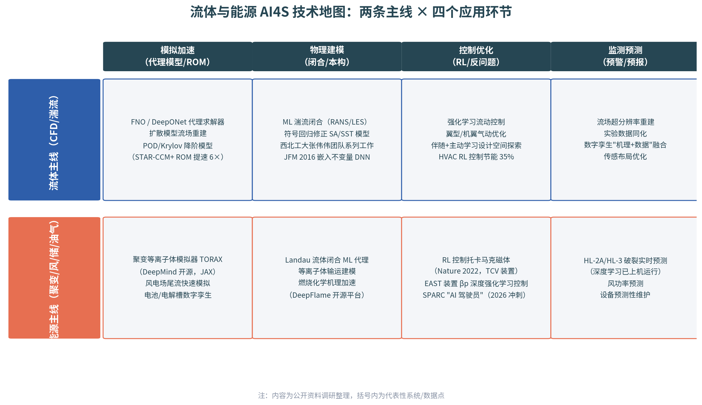

# 流体与能源 AI4S 方向入行指南

> **定位**：本文是《AI4S 全方位调研报告》的姊妹篇，面向已确定聚焦**流体（CFD/湍流）与能源（聚变/风电/储能/油气）**方向的初学者，回答三个问题：这个方向在做什么、去哪里找工作、具体怎么学。
> **调研时间**：2026 年 10 月

---

## 一、方向定位：为什么是流体与能源

在 AI4S 的六大方向中，流体与能源属于"**物理/流体/能源**"象限——学术影响力高、产业化程度中等，但它有一个其他方向不具备的特点：**工业需求极其刚性**。CFD（计算流体力学）是航空、汽车、能源、化工装备的"虚拟试验场"，传统高精度模拟一次算几天、成本数千到数万元；而 AI 代理模型把单次预测压缩到秒级，使"实时仿真""设计空间大规模探索""闭环控制"从不可能变为可能。Siemens 的观察很直白：2025 年任何一场 CFD 学术会议的论文集中，神经算子与降阶模型（ROM）已无处不在，且重点不只是提速，而是**解锁了以前不可能的新应用**[^71^]。

能源侧的动力同样来自"刚需"：可控核聚变被 AI 视为下一个"AI for Science 圣杯级"场景——DeepMind 用深度强化学习控制托卡马克磁体、把等离子体"雕刻"成雪花形、ITER 形等复杂位形的工作登上了 Nature，并开源了等离子体模拟器 TORAX[^75^][^76^]；2025 年 10 月 DeepMind 与 Commonwealth Fusion Systems（CFS）达成合作，目标是在 2026 年竣工的 SPARC 装置（史上首个冲刺"能量净增益"的紧凑型托卡马克）上构建"AI 驾驶员"，围绕可微等离子体模拟、增益最大化路径、实时控制三个方向展开[^72^][^74^]。中国在聚变 AI 上并不落后：EAST 装置已实现基于深度强化学习的 βp 实时反馈控制，HL-2A/HL-3 托卡马克的深度学习破裂预测已嵌入装置控制系统实际运行[^73^]。

## 二、技术地图：两条主线 × 四个环节

上图把该方向的知识体系整理为"流体主线"与"能源主线"两条线、每条线四个应用环节。**模拟加速**（代理模型与降阶模型）是两条线共同的最大公约数，也是入门首选：傅里叶神经算子（FNO）、DeepONet 学习"函数到函数"的解算子，单次评估比传统求解器快达千倍量级；POD/Krylov 等传统 ROM 也在 AI 浪潮中复兴，Siemens STAR-CCM+ 的 Krylov-ROM 已把大型三维系统的单次迭代从 32 秒降到 5.5 秒（提速超 6 倍），并在建筑 HVAC 控制案例中配合强化学习实现 35% 的能耗下降[^71^]。扩散模型是 2024 年以来的新热点，正在从图像生成工具演变为面向流场重建、超分辨率和气动外形生成的"代理模型家族"[^64^]。

**物理建模**环节的核心是湍流闭合：RANS 方程中的雷诺应力项未知，传统靠经验闭合模型（SA、SST 等），机器学习则学习闭合项或修正系数——从 JFM 2016 年 Ling 等人"嵌入伽利略不变量的深度神经网络"开始，西北工业大学张伟伟团队、符号回归修正 SA/SST 模型（可解释、可泛化）等一系列工作已形成成熟谱系[^66^]。更前沿的方向是**等变神经算子**直接学习非局部张量本构模型，把湍流闭合从"点态函数"升级为"算子学习"，可适配任意非结构网格[^65^][^69^]。能源侧对应"等离子体/燃烧闭合"，例如用机器学习代理 Landau 流体闭合、DeepModeling 社区的开源燃烧模拟平台 DeepFlame[^65^]。**控制优化**环节的代表作是 RL 托卡马克控制与 RL 流动控制；**监测预测**环节包括流场超分辨率、实验数据同化、破裂预测与风功率预测[^67^][^70^]。

## 三、工业落地与雇主地图

| 雇主类型 | 代表机构 | 岗位形态 | 进入门槛 |
|-|-|-|-|
| 工业软件巨头 | Siemens（STAR-CCM+/Simcenter PhysicsAI）、ANSYS、达索、Altair | ROM/AI-CFD 产品化工程师、代理模型研发 | 硕士为主，CFD + ML 双背景 |
| AI 公司科学计算团队 | NVIDIA（Modulus/PhysicsNeMo）、DeepMind、华为云、字节 Seed | 神经算子/科学大模型研究员 | 顶会论文，博士为主 |
| 能源央企与装备 | 中核、中广核、国家能源集团、中石油/中石化、金风科技、远景 | 数字孪生、预测性维护、风功率预测工程师 | 硕士，工程背景友好 |
| 聚变科研机构 | 中科院合肥等离子体所（EAST）、西南物理研究院（HL 系列）、CFS、ITER 组织 | 等离子体 + AI 交叉研究岗 | 博士为主，硕博皆宜 |
| 高校与新型研发机构 | 西北工大、清华、北大 AISI、中科院力学所、之江实验室 | 博士后/研究助理/工程师 | 学历门槛高，但工程师岗友好 |

两个择业信号值得注意：其一，**工业软件公司正在把 AI4S 能力产品化**（Siemens PhysicsAI 允许工程师用既有仿真数据直接训练预测模型），这意味着"既懂 CFD 业务流程又能落地 ML 模型"的工程师比纯研究员更稀缺[^71^]；其二，聚变赛道在中美同时升温——美国有 CFS/DOE"创世纪使命"（近 3 亿美元投入聚变实用化），中国有 EAST/HL 系列装置与 BEST/CFETR 工程，**等离子体物理 + 机器学习**的交叉人才供给严重不足[^73^][^74^]。

## 四、学习路径：在原四阶段计划上做"流体能"特化

总体仍遵循主报告的四阶段框架（筑基 → AI 核心 → 科学智能方法 → 领域深耕），以下是流体能方向的特化版本：

### 第 0–3 个月：筑基（与主计划一致，增加流体力学）

- **编程/工具**：Python、Git/Linux，外加 **ParaView**（流场可视化事实标准）
- **数学**：线性代数、微积分、概率论 + **偏微分方程基础**（必须理解 NS 方程各项的物理含义）
- **流体入门**：读一遍《Fluid Mechanics》级别的教材或 MIT OCW 流体力学公开课，会用 **OpenFOAM** 或 **SU2** 跑通一个简单算例（如二维圆柱绕流），理解网格、边界条件、湍流模型、收敛性
- **验收标准**：用 OpenFOAM 复现圆柱绕流卡门涡街，画出升阻力系数曲线

### 第 3–6 个月：AI 核心 + CFD 数据工程

- 机器学习（吴恩达/李沐）与 PyTorch
- **关键能力：生成训练数据**。写脚本批量跑 OpenFOAM/SU2 参数化算例（不同雷诺数、几何），导出场数据为 NumPy 数组——这是流体 AI 的"数据工程基本功"
- 学习网格数据结构与非结构网格上的深度学习方法（点云/图表示），阅读 MeshGraphNets（DeepMind 图网络流体模拟）
- **验收标准**：构建一个含 ≥200 个样本的参数化流场数据集（如周期山丘流动，该数据集是湍流建模领域的标准基准[^65^]）

### 第 6–12 个月：科学智能方法（流体特化）

| 主题 | 学习内容 | 工具/资源 |
|-|-|-|
| 神经算子 | FNO / DeepONet 原理与实现，分辨率不变性 | **neuraloperator**（NVIDIA/Caltech，已入 PyTorch 生态）；PDEBench 基准数据集 |
| PINN | 损失函数设计、刚性问题、与有限体积对比 | **DeepXDE**、NVIDIA Modulus（物理机器学习框架） |
| 湍流闭合 | 雷诺应力建模、不变量特征构造、符号回归 | Ling et al. JFM 2016；张伟伟团队综述；PySINDy（符号回归库） |
| 降阶模型 | POD、Krylov 子空间、非侵入式 ROM | 自编程 + OpenFOAM 数据；Siemens ROM 文档作参考[^71^] |
| 图神经网络 | MeshGraphNets、非结构网格流体预测 | PyTorch Geometric、Google meshgraphnets 开源代码 |

**验收标准（作品集项目 1）**：用 FNO 在 PDEBench 或自制数据集上训练一个 2D 不可压流动代理模型，实现比传统求解器 ≥100× 的推理加速，并写出误差分析报告（对比不同分辨率下的泛化性）。

### 第 12–18 个月：能源方向深耕（二选一或都碰）

- **聚变方向**：学习 TORAX（JAX 编写，DeepMind 开源，可微等离子体模拟[^75^]）；复现 RL 托卡马克控制 toy model（用简化 1D 输运方程 + RL 控制器）；关注中科院等离子体所、西南物理研究院的博后与工程师岗位
- **风电/储能方向**：风资源评估与尾流模拟（学习 OpenWind 类工具 + 代理模型）、风功率概率预测（学习概率机器学习）、锂电池老化建模（公开数据集 NASA PCoE）
- **作品集项目 2（能源）**：TORAX 上训练一个等离子体参数控制策略，或构建一个风电场尾流代理模型
- **作品集项目 3（综合）**：把前两个项目整理成技术博客 + 开源仓库，给 DeepModeling、neuraloperator、Modulus 等社区提交 PR

## 五、练手数据集与开源工具速查

| 资源 | 说明 |
|-|-|
| **PDEBench** | 神经算子标准基准（含 Burgers、NS、Darcy 等 8 类方程） |
| 周期山丘（Periodic Hills）数据集 | 参数化几何湍流建模标准数据[^65^] |
| TORAX | DeepMind 开源托卡马克核心等离子体模拟器（JAX，可微）[^75^] |
| OpenFOAM / SU2 | 开源 CFD 求解器，生成训练数据的利器 |
| neuraloperator / DeepXDE / PySINDy / Modulus | 神经算子 / PINN / 符号回归 / 物理 ML 框架 |
| DeepFlame | DeepModeling 社区的开源燃烧反应流平台 |
| HuggingFace Datasets | 搜 "PDE"、"fluid"、"plasma" 有越来越多公开数据 |

## 六、给流体/能源方向的三条专属建议

**第一，流体 AI 的核心竞争力是"数据工程 + 物理判断"，不是调包。** 同一个 FNO 模型，懂流动的人知道该在什么边界条件下采样、误差该出现在涡街脱落频率还是尾迹宽度，不懂的人只会报告一个平均 L2 误差——企业面试时区分的就是这一点。**第二，聚变方向窗口正在打开但要趁早**：SPARC 计划 2026 年后建成冲刺净增益，中国 BEST/CFETR 紧随其后，未来 3–5 年是"等离子体 + AI"人才定价最高的时期[^74^]。**第三，不要忽视传统 ROM**：POD/Krylov 方法在工业界已大规模产品化（STAR-CCM+），比神经算子更容易在工业软件公司拿到第一份工作，两者结合（如"神经算子加速 ROM"）反而是有差异化竞争力的定位[^71^]。

---

*本指南基于 2026 年 10 月前公开资料调研撰写，仅为一般性信息，不构成职业或投资建议。*
