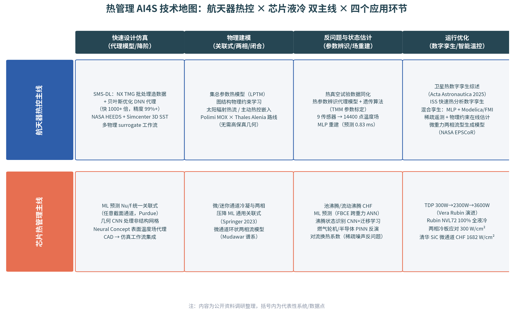

# 热管理背景 AI4S 专项入行计划

> **定位**：本文是《AI4S 全方位调研报告》与《流体与能源 AI4S 入行指南》的姊妹篇，面向**航天器及算力卫星热控系统、高热流密度芯片热管理**行业背景的初学者，回答：你的背景在 AI4S 中处于什么位置、机会在哪里、18 个月怎么学。
> **调研时间**：2026 年 10 月

---

## 一、定位：你的背景为什么是天选的 AI4S 交叉点

AI4S 的所有方法——代理模型、物理约束神经网络（PINN）、神经算子、数字孪生——本质上都在解决同一个问题：**物理仿真太慢、太贵、数据太稀疏，而用 AI 加速、反演、在线化**。热管理恰好是这个问题最尖锐的领域之一，因为它同时叠加了三重刚需：高热流密度（芯片 TDP 一路从 V100 的 300W 涨到 H100 700W、B200 约 1000W、GB300 1400W，预计 2026 年的 Vera Rubin VR200 达 2300W、2027 年 VR300 达 3600W，而风冷极限只有 700–800W/芯片、约 20kW/柜，Rubin NVL72 机柜已确定 100% 全液冷并于 2026Q3 交付[^78^]）、强约束设计（航天器热控受重量、功耗、可靠性三重约束，传统热模型一次分析动辄数小时）、以及稀疏观测（天上只有十几个测温点，要推断整星 上万节点的温度场）。市场侧的信号同样明确：AI 数据中心液冷渗透率 2024 年仅 14%，2025 年随 GB200 NVL72 放量跳升至 33%[^77^]；中国液冷市场 2024 年约 184 亿元（同比 +66%），预计 2029 年达约 1300 亿元[^80^]。**热流密度从 50 向 100–150 W/cm² 攀升、Rubin 架构突破 150 W/cm² 的趋势，正在把"热"从辅助学科推向算力基础设施的瓶颈学科**[^80^]。

更关键的是方法论层面的匹配度。你日常工作里的共轭传热（固体导热 + 流体对流耦合）、微通道/两相流换热、辐射换热，正是 AI4S 文献里最成熟的应用区：卫星热控一侧，中科院长春光机所的 SMS-DL 框架用 NX TMG 批量仿真自动造数据、贝叶斯优化 DNN 做代理，比传统热模型快 1000 倍以上、精度 99% 以上，还能迁移学习适配新工况（在中国空间站巡天望远镜紫外探测器上精度提升 ≥86.4%）[^88^]；米兰理工 MOX 与 Thales Alenia 合作的卫星热数字孪生，用集总参数热模型（LPTM）+ 图结构 + 稀疏测温遥测数据学习 + 物理约束（太阳辐射热流、主动热控），完全不需要高保真几何就能在线估计全星温度场[^86^]；EUCASS 2023 的混合数字孪生用 MLP 从 9 个传感器重建 1.2 米舱体 14400 个点的温度场，平均绝对误差 0.0121、单次预测仅 0.83ms，并实现了 FMI/Modelica 集成[^87^]。芯片一侧，Purdue 的学位论文已把"ML 代理任意截面通道的 Nu/f 统一关联式 + 数千几何批量 CFD 自动化 + 冷板设计优化 + 与拓扑优化结合"串成完整工作流[^92^]，清华孙波团队的两相微通道散热在 SiC 芯片 >1000 W/cm² 热流密度下实验测得临界热流密度（CHF）1682 W/cm²、COP>19000，模拟预测可达 4000 W/cm²[^82^]。**这两个场景的技术栈（代理模型、图学习、反问题、数字孪生）与 AI4S 主流方法完全重合，你欠缺的只是 AI 方法栈本身——而这恰是最容易系统补齐的一块。**

## 二、技术地图：双主线 × 四环节

上图把热管理 AI4S 整理为"航天器热控"与"芯片热管理"两条主线，每条线四个应用环节。读这张图有一个重要视角：**四环节是同一个技术栈在不同生命周期阶段的投射**——设计阶段用代理模型加速（SMS-DL、几何 CNN[^90^]），建模阶段用 ML 学关联式与闭合（两相压降通用关联式[^93^]、MLP 雷诺应力式类比到换热关联式），试验/在轨阶段做反问题（热参数辨识[^85^]、换热系数 PINN 反演[^96^]、稀疏传感器场重建[^87^]），运行阶段做数字孪生与智能温控（卫星热数字孪生[^83^][^86^]、ISS 快速热分析[^89^]）。这意味着你学一遍方法栈，可以同时覆盖两个主线、四个环节。

特别值得注意的三个方法学信号：其一，**图网络是航天器热控的天然表示**——LPTM 本身就是节点-热容、边-热导的图结构，MOX 路线证明稀疏遥测 + 图学习可以替代高保真模型[^86^]；其二，**反问题是你的主场**——热真空试验标定、在轨温度场重建、对流换热系数反演，本质都是"稀疏观测 + 物理约束"的反问题，PINN 在这类问题上比正问题更有优势[^96^]；其三，**两相流是芯片侧的下一个技术高地**——信通院报告指出两相冷板可应对 300 W/cm²、全液冷冷板为主流选型、GB300 首次引入微通道冷板[^78^][^79^]，而两相压降/换热关联式正是 ML 关联式建模论文最密集的领域[^93^][^94^]。

## 三、沸腾与两相蒸发传热器件：重力/微重力环境下的 AI 设计

沸腾传热利用汽化潜热，是突破单相对流热流密度上限的唯一路线，也是你这个双背景之外的"第三场景"。对航天器而言，两相系统比单相更轻、更紧凑、能承载更大冷却负荷，是国际空间站流动沸腾与冷凝实验（FBCE，Purdue 与 NASA Glenn 合作，2021 年 8 月上站、2022 年 2–7 月完成大规模在轨实验）的核心动机——该实验建立了前所未有的微重力流动沸腾与 CHF 数据库[^98^]。但重力是这个领域的隐藏变量：抛物线飞行中的 FC-72 实验证明换热随重力增大而增强、微重力下减弱[^100^]；微重力下气泡不再周期性脱离、而是长时间附着加热面，蒸汽逐渐覆盖加热面导致 CHF 提前到来，NASA Task Book 因此在资助"用深度视觉重新审视 ISS 微重力沸腾数据"的课题[^104^]；在轨加注液氧贮箱的沸腾模拟（VOF + Marangoni 对流 + 动态接触角）进一步显示，微重力下气泡脱离由 Marangoni 力主导、脱离直径从 >5 mm 缩小到 0.3–0.6 mm[^101^]。这些"重力标度"问题决定了器件设计的物理主导机制完全不同：地面设计靠浮力排汽，空间设计必须靠剪切力、毛细力与表面张力（低 Bond 数工况）[^100^]——**这意味着同一类器件（如微通道两相冷板）在地面芯片与星上载荷上是两个设计问题，而你恰好两边都懂**。

机器学习已经渗透到这一领域的每一层。预测层：Purdue/NASA 用 ANN 统一预测地球重力与微重力下的流动沸腾换热系数与 CHF（基于 FBCE 数据库）[^98^]；核反应堆 CHF 预测已出现"物理增强神经网络集成 + 不确定性量化"的工作[^99^]，考虑流量振荡的 CHF-ANN 能对 85% 的数据做到 ±10% 相对误差[^98^]。状态识别层：CNN、声发射频谱 + 迁移学习用于沸腾区域与膜态沸腾识别，迁移学习专门解决跨工况泛化瓶颈[^105^][^106^]。器件设计层：DLR 的脉动热管（PHP）研究用 3,473 个文献数据点训练 XGBoost + SHAP 可解释模型预测热阻，发现最优充液率约 50–60%、蒸发段朝下的垂直布置性能最优，并明确指出 CFD 模拟太慢、ML 才是支撑设计空间探索的工具[^102^]——这与你之前关注的振荡热管（OHP）共轭传热数据同化工作[^95^]正好形成"物理建模 + ML 设计"的闭环。更前沿的是 NASA 内布拉斯加 EPSCoR 项目在做微重力两相流型的生成式重建（从工况直接生成流型图像），目标直指航天两相热控/低温系统的数字孪生[^103^]。

| 器件 | 重力环境 | 物理主导机制 | AI 切入点 | 代表工作 |
|-|-|-|-|-|
| 微通道流动沸腾冷板 | 地面（AI 芯片） | 强制对流 + 核态沸腾 | CHF/HTC 预测、流道参数优化 | Purdue/NASA ANN[^98^]；清华两相微通道 CHF 1682 W/cm²[^82^] |
| 微通道两相 | 微重力（星上载荷） | 剪切力排汽（低 Bond 数） | 跨重力统一关联式、流型生成模型 | FBCE 数据库[^98^]；NASA EPSCoR 生成式流型[^103^] |
| 池沸腾 / 浸没冷却 | 地面（数据中心） | 浮力排汽 | 沸腾状态识别、CHF 实时预警 | CNN + 迁移学习[^105^][^106^] |
| 脉动/振荡热管（PHP/OHP） | 重力强敏感 | 重力 + 毛细 + 相变振荡 | 热阻代理 + SHAP 可解释设计 | DLR XGBoost（3,473 数据点）[^102^] |
| 毛细泵两相回路（CPL/LHP） | 重力不敏感，最适合空间 | 毛细抽吸 | 启动/瞬态预测、数字孪生 | MOX 图学习孪生路线可迁移[^86^] |
| 低温推进剂贮箱沸腾 | 微重力在轨管理 | Marangoni + 表面张力 | VOF 仿真加速代理、热控策略优化 | 液氧在轨加注沸腾模拟[^101^] |

**给你的定位建议**：重力强敏感的器件（PHP/OHP、池沸腾）在微重力下性能退化明显，设计时必须把重力作为显式输入变量——这正是 ML 相对传统关联式的天然优势（传统关联式很少跨重力标定）[^98^][^102^]；重力不敏感的器件（CPL/LHP、微通道剪切主导区）是近地轨道与深空任务的默认选项，AI 切入点在瞬态预测与孪生。若你能接触到落塔、抛物线飞行或空间站载荷类的微重力试验渠道，"微重力沸腾 + ML"的数据与模型组合在国内几乎无人竞争。

## 四、你的独特优势与雇主地图

**优势盘点**：相比纯 CS 出身的 AI4S 新人，你拥有三样他们短期内拿不到的东西——**领域判断力**（知道误差该出现在哪个热节点、哪个工况是危险的）、**数据与算例访问权**（热真空试验数据、热模型、微通道测试数据，这正是 SMS-DL、MOX 等工作的最大门槛[^85^][^88^]）、**工程问题定义能力**（知道什么是值得 AI 解的问题）。你缺的只是 Python/ML/神经算子这套方法栈，而这恰恰是可以按路径系统补齐、且 12–18 个月足以见效的部分。

| 雇主类型 | 代表机构 | 岗位形态 | 你的匹配度 |
|-|-|-|-|
| 航天科技/科工院所 | 总体部、五院/八院各所热控专业 | 热控数字孪生、智能热控预研 | ★★★★★（你的本行 + AI 增量） |
| 卫星互联网/算力卫星 | 星网、银河航天、垣信等 | 载荷热控、在轨健康管理 | ★★★★★（算力卫星 = 你的两个背景叠加） |
| 液冷厂商 | 英维克、曙光数创、高澜股份、Nidec 等 | 冷板/两相/微通道设计 + AI 辅助设计 | ★★★★（需补 CFD 与两相流深度） |
| 芯片/服务器热设计 | NVIDIA 供应链、国产 GPU 厂、ODM | 封装-冷板协同设计、热仿真自动化 | ★★★★ |
| 工业软件 | Siemens、ANSYS、达索 | 热-流体 AI 产品化工程师 | ★★★（CFD/热仿真 + ML 双背景） |
| AI4S 创业公司 | 物理 ML、工业孪生方向初创 | 算法/应用工程师 | ★★★（看作品集） |

两个择业信号：算力卫星是"航天器热控"与"芯片热管理"两条主线的物理交汇点——星上算力载荷的热流密度正在快速逼近地面 AI 芯片水平，单机柜千瓦级散热 + 太空辐射散热的双重约束使热控成为星座设计的核心瓶颈，这是你有独家身位优势的赛道。同时，液冷行业的爆发（184 亿→1300 亿元市场[^80^]）意味着"懂两相/微通道 + 会 AI 辅助设计"的工程师在供给端几乎空白——3D 打印微通道冷板已经在量产导入[^80^]，但设计仍靠工程师经验反复试算，正是代理模型与拓扑优化最容易切入的环节[^92^]。

## 五、18 个月个性化学习路径

总体遵循前两份报告的四阶段框架（筑基 → AI 核心 → 科学智能方法 → 领域深耕），以下是你的特化版。

### 第 0–3 个月：筑基

- **编程/工具**：Python、Git/Linux、Jupyter；ParaView（热-流场可视化）
- **数学**：线性代数、微积分、概率论 + 偏微分方程（重点理解热传导方程、对流边界条件、共轭传热耦合的数学形式）
- **专业重温**：把你熟悉的共轭传热用 Python 手写一个有限差分/有限体积求解器（1D/2D 热传导 + Robin 边界），这是后面所有 AI 方法的"真值机"
- **验收标准**：手写 2D 稳态共轭传热求解器，与商用软件（NX TMG / Fluent / Icepak 任一）对比误差 <1%

### 第 3–6 个月：AI 核心 + 热仿真数据工程

- 机器学习（吴恩达/李沐）与 PyTorch
- **关键能力：批量造数据**。写一个驱动 NX TMG / Icepak / OpenFOAM 的自动化脚本（参考 SMS-DL 的批处理思路[^88^]），参数化几何（肋片间距、流道截面、冷板厚度）与工况（热流密度、流量、入口温度），批量导出温度场为 NumPy 数组
- 学 PINN 基础（DeepXDE），先解你最熟的正问题：2D 热传导 + 对流边界
- **补两相基础**：Bond 数、Jakob 数、流型图、Zuber–Kutateladze 类 CHF 机理模型——这是看懂微重力数据的语言[^98^][^100^]
- **验收标准**：构建 ≥300 样本的参数化冷板共轭传热数据集

### 第 6–12 个月：科学智能方法（热管理特化）

| 主题 | 学习内容 | 你的对应应用 |
|-|-|-|
| 代理模型 | DNN/GPR/贝叶斯优化代理；几何 CNN 处理非结构网格[^90^] | 热模型加速（对标 SMS-DL[^88^]） |
| 图神经网络 | PyG；图结构 LPTM 学习[^86^] | 卫星集总热模型在线估计 |
| 神经算子 | FNO / DeepONet（neuraloperator 库） | 变几何冷板温度场预测 |
| PINN 反问题 | 损失函数设计、稀疏观测反演[^96^] | 换热系数反演、热参数辨识[^85^] |
| 两相沸腾预测 | CHF/HTC 的 ANN/XGBoost 代理、SHAP 可解释性 | 跨重力 CHF 预测（对标 FBCE-ANN[^98^]）、PHP 热阻设计（对标 DLR[^102^]） |
| 数字孪生 | Modelica/FMI 混合孪生、稀疏数据同化[^87^] | 在轨温度场重建 |

**作品集项目 1（第 9–12 个月）：卫星热控数字孪生 toy model**——用 10–20 个热节点的 LPTM 图网络 + 3–5 个"传感器"测温点，学习全节点温度（对标 MOX 路线[^86^]、9 传感器重建 14400 点工作[^87^]），画出训练/外推误差曲线。这是可以直接讲给航天院所面试官的项目。

### 第 12–18 个月：领域深耕与第二个作品集

- **作品集项目 2（第 12–15 个月）：微通道冷板 AI 设计工作流**——用第 3–6 月的数据集训练 Nu/f 或温度场代理（对标 Purdue 统一关联式工作[^92^]），接一个贝叶斯优化或拓扑优化循环自动寻优流道截面，目标函数是热阻 + 压降的加权
- **作品集项目 2 进阶版（两相）：沸腾器件 CHF/热阻预测器**——复现 Purdue/NASA 的跨重力流动沸腾 ANN（FBCE 数据路线）[^98^]，或用公开文献数据复现 DLR 的 PHP 热阻 XGBoost + SHAP 设计模型（3,473 数据点，充液率/倾角/几何为输入）[^102^]；再进一步可加迁移学习做沸腾状态识别（对标[^106^]）
- **进阶选学**：微/迷你通道两相压降 ML 关联式（复现[^93^][^94^]）、微重力两相流型生成模型（NASA EPSCoR 方向[^103^]）、强化学习智能温控（卫星主动热控回路，变工况下最小化功耗）
- **职业动作**：把两个项目整理成技术博客 + 开源仓库；内部争取一个"热控 + AI"试点课题（哪怕是用代理模型替代一次重复性热分析）

## 六、数据/工具速查表

| 资源 | 说明 |
|-|-|
| DeepXDE / neuraloperator / PyG / NVIDIA Modulus | PINN / 神经算子 / 图网络 / 物理 ML 框架 |
| OpenFOAM / SU2 | 开源 CFD，造共轭传热训练数据 |
| NX TMG / Icepak / Simcenter 3D | 你在行的热仿真工具，批处理脚本化后即数据工厂[^88^] |
| FMI / Modelica (OpenModelica) | 数字孪生混合集成标准[^87^] |
| 微通道/两相公开数据 | 文献附表（Mudawar 谱系[^94^]）、Springer 通用关联式论文[^93^] |
| PDEBench | 神经算子基准（含热传导类方程） |
| FBCE / ISS 微重力两相数据库 | Purdue + NASA Glenn 在轨实验数据，跨重力 ANN 训练的数据源[^98^] |
| Brunel Two-phase Flow Database | 小/微管流动沸腾换热公开数据库[^107^] |
| 微重力沸腾建模参考 | 液氧在轨加注 VOF + Marangoni 模拟[^101^]；抛物线飞行 FC-72 实验[^100^] |
| Physics-enhanced NN CHF 集成 | 带不确定性量化的 CHF 预测实现参考（Frontiers 2025）[^99^] |

## 七、四条专属建议

**第一，从反问题切入，而不是从正问题切入。** 纯 CS 出身的人做 AI4S 的默认入口是"代理模型加速正问题"，但你的数据优势在反问题：热真空试验标定、在轨稀疏遥测反演、换热系数辨识——这些问题的数据只有你有，PINN 在这类问题上对数据量的要求也比纯数据驱动方法低[^96^]。这是你最快建立差异化的路线。**第二，把工作中的重复性热分析当作第一个落地场景。** SMS-DL 的起点就是"批量 NX TMG 仿真 + 贝叶斯优化 DNN"[^88^]——你不需要等学完所有方法，第 6 个月就可以用 GPR/DNN 代理替代组里某类参数扫描分析，立刻产生可见价值。**第三，盯住两相微通道这个交汇点。** 它同时是芯片侧的下一个高地（300 W/cm²[^79^]、清华 CHF 1682 W/cm²[^82^]）和 ML 关联式文献最密集的地方[^93^][^94^]，又有 3D 打印量产趋势[^80^]——"两相 + 微通道 + AI 设计"是你 18 个月后最有定价权的能力组合。**第四，把"沸腾 × 微重力"做成你的个人标签。** 这个交叉点全球做的人都很少——FBCE 的跨重力 ANN[^98^]、微重力流型生成模型[^103^]、ISS 沸腾数据的深度视觉重分析[^104^]都还是早期课题；而国内载人登月、空间站载荷、在轨加注在快速推进，微重力两相数据极度稀缺。如果你能接触到落塔、抛物线飞行或空间载荷试验渠道，哪怕先做一个 PHP 热阻 ML 设计器（纯文献数据即可起步[^102^]），也已经站到了供给空白处。

---

*本计划基于 2026 年 10 月前公开资料调研撰写，仅为一般性信息，不构成职业或投资建议。*
