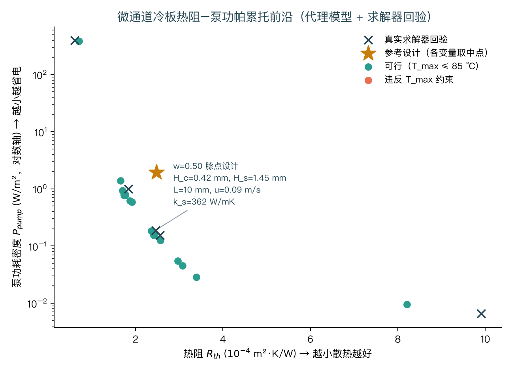

# 微通道冷板 AI 设计工作流 · 作品集项目 2

> 从「自己写一个经过验证的共轭传热求解器」→「批量造数据」→「代理模型 + 可解释性」→「多目标优化」→「用真实求解器回验最优解」的完整闭环。
> 对应《热管理背景 AI4S 专项计划》18 个月路线中的**作品集项目 2**（第 12–15 个月）。

## 这个项目想证明什么

AI4S 项目最容易出的问题不是模型不够先进，而是**"真值"本身不可信**：
拿一个没验证过的求解器（或来路不明的数据集）训练代理模型，再拿代理模型去优化，
最后交付的是一串没人能复现的数字。本项目的组织顺序刻意反过来：

```
先验证求解器  →  再造数据  →  再训代理  →  再优化  →  最后回到求解器回验
```

每一步都有可执行的验收脚本，任何一处不通过，"最优设计"就不成立。

## 快速开始

```bash
pip install -r requirements.txt

python src/verify_solver.py     # ① 13 项解析解验证（必须先通过）
python src/make_dataset.py      # ② 800 个样本，约 5 秒
python src/train_surrogate.py   # ③ 标量代理 + POD 温度场降阶模型
python src/optimize.py          # ④ 帕累托前沿 + 求解器回验
```

## ① 求解器：先证明它是对的

`src/conjugate_solver.py` 实现二维稳态**共轭传热**（固体导热 + 流体对流耦合）的
有限体积求解，`src/verify_solver.py` 用解析解逐项验证：

| 基准 | 检验内容 | 结果 |
|-|-|-|
| A 一维稳态导热 | 离散格式与边界条件 | 温度场最大误差 **2.3×10⁻¹² K** |
| B 能量守恒 | 底部加热 = 流体焓升 + 顶面导出（3 个工程工况） | 相对误差 **~10⁻¹²** |
| C 发展段剖面 | 与平行平板闭式解 θ(η) 逐点比较 | 最大偏差 **0.0047%**；局部 Nu **5.38469**（解析值 5.385） |
| D 网格收敛 | 横向加密 8→64 | 误差 0.338%→0.0047%，**收敛阶 2.0–2.1** |
| E 假设审计 | 速度剖面充分发展假设的适用范围 | 见下 |

`verify_solver.py` 退出码即验收：**13/13 项通过**。

### 验证过程抓到的三个真实 bug

这份验证不是走过场——它确实抓出了会让整个数据集失真的错误：

1. **顶面定温边界用错了面导热系数**。边界只在半个单元格之外，面导热系数应是
   `2k·dx/dy`；误用单元格之间的值时，一维导热基准的误差是 0.021 K（约 1.4%）。
2. **在流体里保留了轴向导热，造成 4% 的输入功率凭空消失**。入口按"整列定温"处理时，
   紧邻热壁的入口单元变成人为热汇，固体轴向导过去的热被它吸收后不再出现。
   修正：入口改为按迎风指定**流入通量**的温度。流体侧的轴向导热则整体去掉
   （轴向 Pe ≈ 10²–10⁴，抛物化近似成立），固体侧必须保留——那正是"上游预热"的机制。
3. **发展段努塞尔数不收敛**。排查后确认不是格式缺陷：定热流边界下 Nu 向渐近值的
   收敛是**代数式**的（~1/x），壁面附近流速趋零使该区域需要极长的通道才达到渐近剖面。
   基准因此取到 `L/D_h = 10⁵`，之后 Nu 收敛到 5.385、剖面偏差降到 0.005%。

## ② 数据集：把"模型假设失效区"显式排除

`src/design_space.py` 定义 6 个设计变量（通道高度、基板厚度、流向长度、平均流速、
热流密度、固体导热系数）并施加两条约束：

- **模型有效性**：`Le,h/L ≤ 1`。求解器假定速度剖面已充分发展，而流动入口段长度
  `Le,h ≈ 0.05·Re·D_h`。审计显示**均匀采样下只有约 42% 的组合满足这条约束**——
  也就是说"随手采样"会让近六成样本落在模型假设失效的区域。采样器因此让流速上限
  与通道高度、长度耦合，约束由参数化保证。
- **物理有效性**：单相液态水只在 `T_max < T_sat` 时成立。

`src/make_dataset.py` 产出 800 个样本（含温度场快照，7 MB），**31% 满足
`T_max ≤ 85 °C`**。这个比例本身就是结论：

> **单相微通道冷板的能力边界大约在 100 W/cm² 量级。** 热点约束 `T_max − T_in = q″·R_th ≤ 58 K`，
> 而本项目设计空间内可达的最小热阻约 `6×10⁻⁵ m²·K/W`，对应上限约 **97 W/cm²**。
> 想突破这条线必须转向两相沸腾换热——这正是《热管理背景 AI4S 专项计划》里
> 把两相列为"下一个技术高地"的定量依据。

## ③ 代理模型

### 标量指标（5 折交叉验证）

| 目标 | 最佳模型 | CV R²（全部样本） | MAPE | R²（可行子集） |
|-|-|-|-|-|
| 热阻 `R_th` | HGB | 0.886 | 3.8% | **0.983** |
| 泵功耗 `P_pump` | MLP | **0.997** | 5.5% | 0.996 |
| 压降 `Δp` | MLP | 0.985 | 7.9% | 0.980 |
| 努塞尔数 `Nu` | MLP | 0.955 | 1.2% | 0.987 |
| 热点温度 `T_max` | **由 R_th 导出** | 0.958 | **1.0%** | 可行子集 MAPE **0.38%** |

**一个值得单独讲的建模决定**：`T_max` 不直接用模型拟合，而由定义式导出
`T_max = T_in + q″·R_th`。因为 `R_th ≡ (T_max − T_in)/q″` 本身就是定义关系，
独立拟合既浪费容量又更不准：

| 建模方式 | R² | MAPE | 可行子集 MAPE |
|-|-|-|-|
| 直接拟合 `T_max` | 0.9175 | 2.24% | 1.42% |
| **由 `R_th` 导出** | **0.9581** | **1.02%** | **0.38%** |

这个决定不是审美问题：早期版本直接拟合 `T_max`，优化器给出的"最省泵功设计"
在**真实求解器回验时热点温度差了 28 K、直接违反约束**。改用导出式后，回验
可行率从 4/5 变成 **5/5**。

### 可解释性（SHAP）

热阻模型的特征重要性排序：**平均流速 u ≫ 流向长度 L > 通道高度 H_c > 固体导热系数 k_s > 基板厚度 H_s > 热流密度 q″**。

前四项符合物理直觉（对流热阻与泵送温升都由流速主导；`R_th` 按定义已对 `q″` 归一化，
所以 `q″` 几乎不影响它——这反过来验证了代理模型学到的第一性关系是正确的）。

### 温度场降阶模型（POD）

对 800 个温度场快照做本征正交分解：**4 个模态即解释 99.92% 的能量**，
用梯度提升树把设计参数映射到模态系数后，温度场重构 RMSE 24.3 K，
**由重构场读出的热点温度 MAPE 仅 2.45%**。

温度场如此低维，是因为它本质上是"沿流向近似线性的温升 + 横向近抛物剖面"。
这也解释了为什么经典 ROM（POD）在这个问题上就够用——工业软件走这条路线是有道理的。

## ④ 多目标优化与闭环验证

目标：`min J = w·(R_th/R_ref) + (1−w)·(P_pump/P_ref)`，约束 `T_max ≤ 85 °C`
（按 `limit − 3 K` 施加安全余量）。扫 `w ∈ [0,1]` 得到**帕累托前沿**：



**闭环验证**——把前沿上的设计点代回真实共轭求解器：

| w | 代理 R_th | 求解器 R_th | 偏差 | 代理 T_max | 求解器 T_max | 求解器可行性 |
|-|-|-|-|-|-|-|
| 0.00 | 8.209 | 9.903 | 17.1% | 346.4 K | 356.0 K | ✅ |
| 0.25 | 2.420 | 2.564 | 5.6% | 353.0 K | 356.1 K | ✅ |
| **0.50** | 2.377 | 2.459 | **3.4%** | 332.9 K | 334.1 K | ✅ |
| 0.75 | 1.738 | 1.837 | 5.4% | 320.7 K | 321.8 K | ✅ |
| 1.00 | 0.706 | 0.608 | 16.2% | 325.7 K | 322.1 K | ✅ |

（单位：`R_th` 为 10⁻⁴ m²·K/W）

**结论要连边界一起读**：膝点附近代理模型误差只有 3–5%，但推到帕累托两端会放大到
16–17%。也就是说这份代理模型的可靠工作区是前沿中段，两端的设计要么需要加密采样、
要么必须直接过求解器。把这句话写进结论，比只报一个"R²=0.886"有用得多。

## 目录结构

```
microchannel-coldplate-ai/
├── README.md
├── requirements.txt
├── src/
│   ├── conjugate_solver.py   ← 共轭传热有限体积求解器
│   ├── verify_solver.py      ← 13 项解析解验证（先跑这个）
│   ├── design_space.py       ← 设计空间 + 两条有效性约束
│   ├── make_dataset.py       ← 参数化采样 + 批量求解
│   ├── train_surrogate.py    ← 标量代理 + POD 降阶模型 + SHAP
│   └── optimize.py           ← 帕累托前沿 + 求解器回验
├── data/                     ← 数据集（npz 含温度场 + csv + meta）
└── outputs/                  ← 验证结果、代理指标、帕累托前沿图
```

## 模型局限（明确写出来）

1. **速度剖面是输入的，不是解出来的**。求解器假定充分发展的平面 Poiseuille 剖面，
   只在 `Le,h/L ≤ 1` 内使用。真实的入口段流动需要抛物化或全 Navier-Stokes 求解。
2. **单相、常物性**。忽略沸腾、物性随温度变化与黏性耗散；`T_max > 85 °C` 的样本
   只有"数学解"意义，没有物理意义（数据集里用 `feasible` 列标出）。
3. **压降用的是与假设剖面一致的解析式**（`f·Re = 96`），不包含入口效应与粗糙度。
4. **二维单元胞**，不分辨通道宽向与歧管分配不均；结果应按"每单元宽度"理解。
5. **代理模型不能外推**：训练域之外、以及帕累托两端（误差可到 17%）不可直接使用。

## 与知识库其他部分的关系

- 复现脚本与文档中的技术地图（`docs/assets/fig6_thermal_map.png`）对应；
- 对标工作时，`docs/参考文献.md` 中 [92]（Purdue 统一关联式 + 批量 CFD）、
  [86]（MOX/Thales 图结构数字孪生）、[88]（长春光机所 SMS-DL 代理）是本项目方法学的直接来源；
- 与 `projects/php-thermal-resistance/`（作品集项目 1）共用"造数据 → 代理 → SHAP → 优化"的骨架，
  但本项目多了**求解器自验证**与**优化结果回验**两个环节。

---

*本项目的定量结论全部可由上述四个脚本复现；求解器与其验证套件是自研实现，未经第三方基准测试。*
