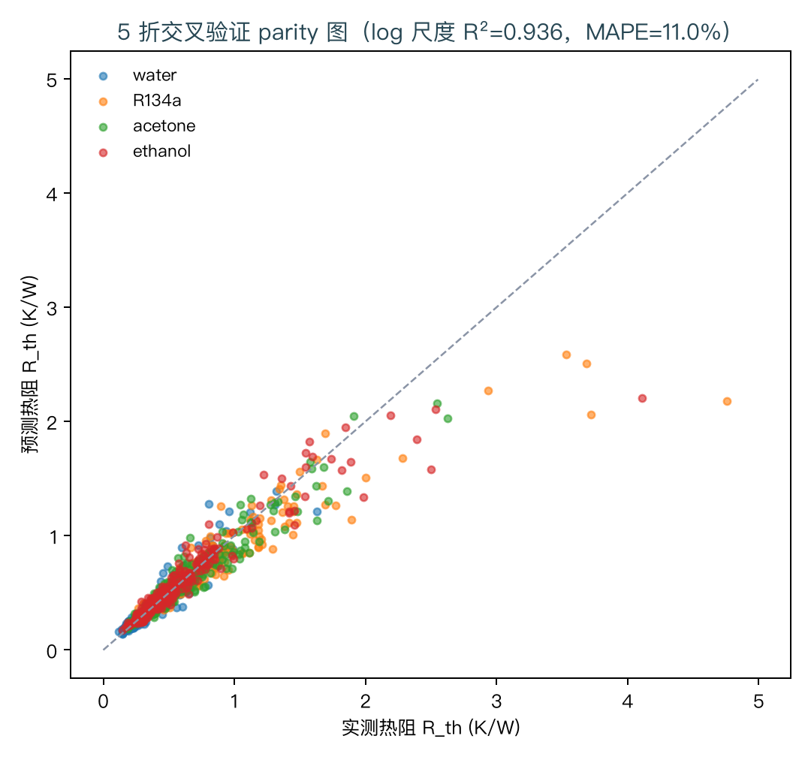
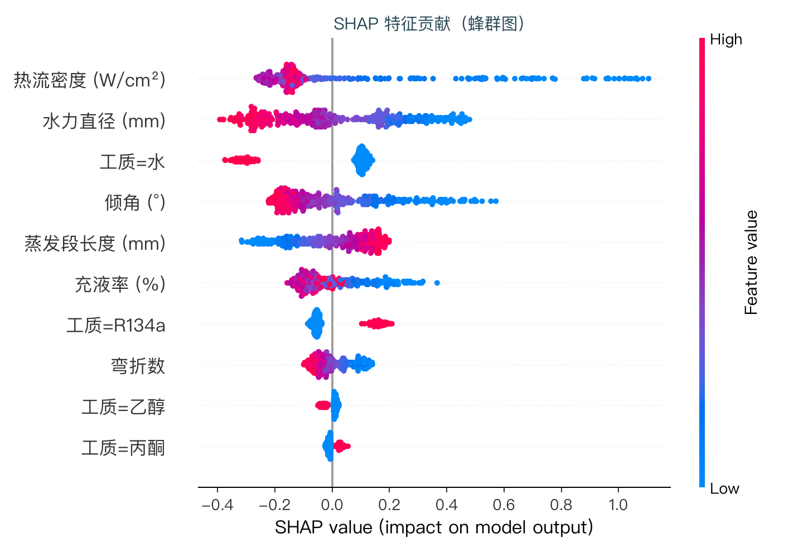
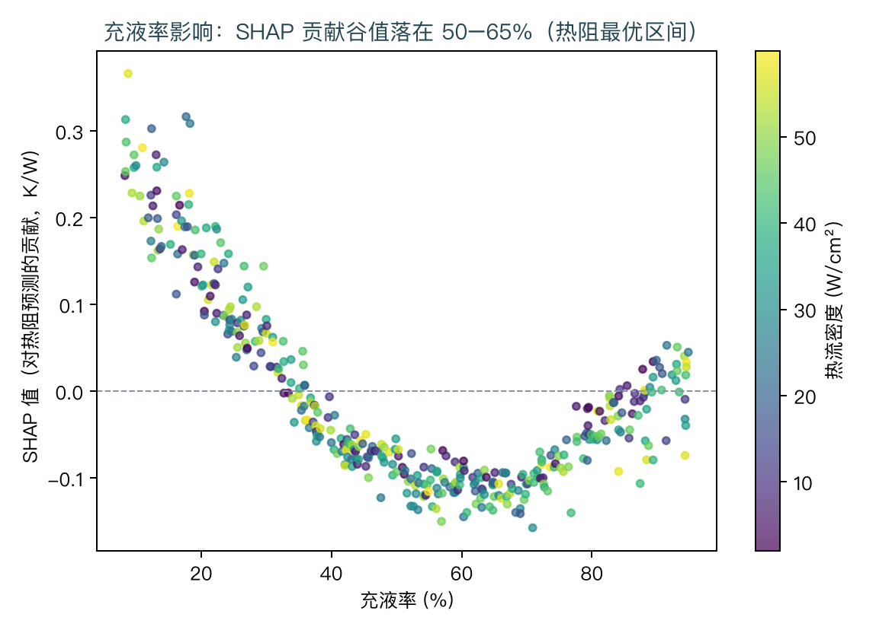
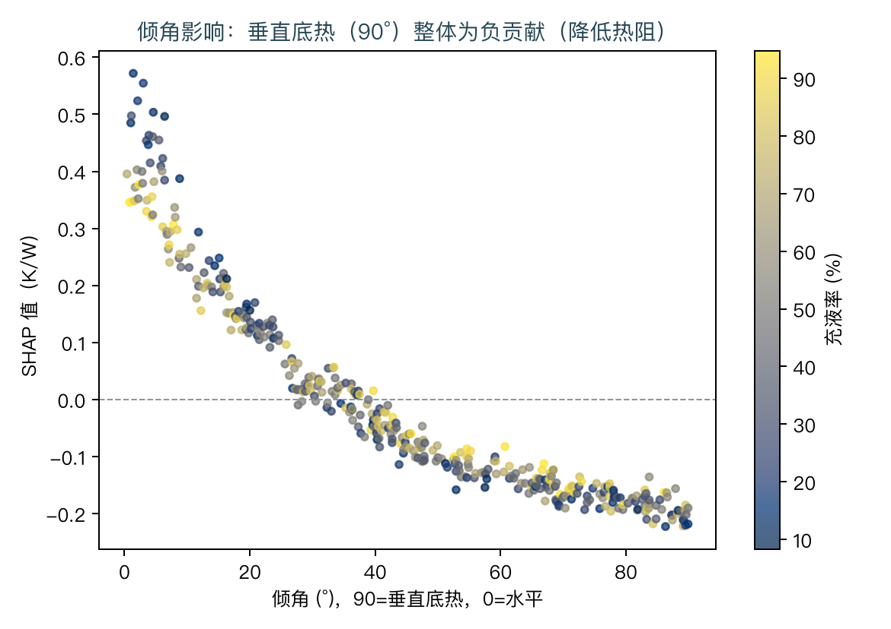
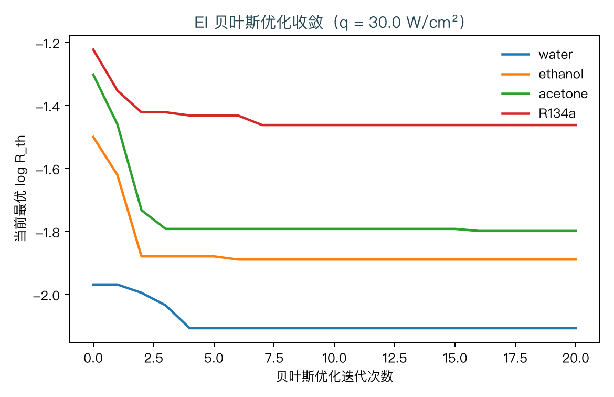
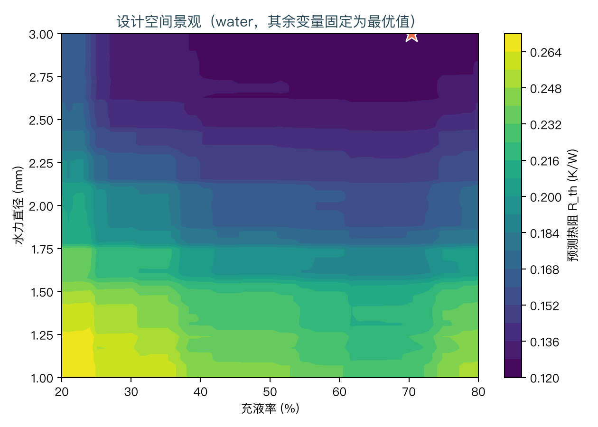

# 不搭实验台，用公开文献数据训一个脉动热管热阻预测器：XGBoost + SHAP + 贝叶斯优化的完整闭环

> **副标题**：从"数据从哪来"到"最优设计长什么样"——一个零硬件门槛的 AI4S 练手项目
> 代码与数据：项目仓库（`projects/php-thermal-resistance`，含完整复现脚本）
> 阅读时间：约 12 分钟

---

## 一、为什么做这个题目

脉动热管（PHP/OHP）是少数几种**无运动部件、靠相变振荡传热**的器件：弯折毛细管里工质自发形成气塞-液塞，在蒸发段吸热、冷凝段放热，靠振荡把热量"泵"走。它结构简单、柔性可弯、抗重力裕度大，从卫星热控到 GPU 浸没冷却都有人用。

但设计它很痛苦。管内两相流动是强非线性、强瞬态过程，DLR（德国宇航中心）在最近一项研究里说得直白：传统 CFD 要么算得准但慢得没法用于设计空间探索，要么快但精度打折——**他们最终选择了机器学习路线，用 XGBoost + SHAP 在 3,473 个文献数据点上建立了热阻预测模型（RMSPE 20.2%，R²=0.941），并明确指出 ML 才是支撑 PHP 大规模设计空间探索的工具**。

这篇文章**按同一口径**搭建一条任何人都能跑通的最小闭环（先用合成数据把流程跑通，再换真实文献数据）：

> ⚠️ **先说清楚口径**：下文所有定量结果都基于 `make_demo_data.py` 生成的**物理启发式合成数据（1,000 行）**，
> 它**不是对 DLR 那篇文献的复现**——数据集、样本量（1,000 vs 3,473）与误差口径（MAPE vs RMSPE）都不同。
> 合成数据的作用只有一个：让流程在没有实验条件、没有数字化数据的阶段就能端到端跑起来并被检验。
> 另外，该基准文献是一篇**本科毕业论文**，原文自述模型限定于"底部加热 + 平面蛇形"构型，
> 所以它"垂直底热最优"的结论包含数据集偏向，不宜直接外推。

```
文献数据（数字化）→ 热阻预测模型 → SHAP 可解释分析 → 贝叶斯优化寻优设计
```

整个流程在笔记本电脑上约 40 秒跑完，不依赖任何实验条件。

## 二、数据从哪来：公开文献就是数据矿

这是本项目最想传递的信息：**热管理领域的 ML 入门不需要自己搭实验台，文献曲线就是数据集**。

核心数据源是一份 DLR 学位论文（开放获取），作者系统汇总了以往 PHP 实验文献共 3,473 个数据点，特征包括热流密度、有效换热面积、充液率、倾角、水力直径、弯折数和无量纲数，目标是热阻 R_th。围绕它还可以从多篇实验文献中用 WebPlotDigitizer 之类的工具数字化曲线补充数据——例如：

- Wang et al.（*Applied Thermal Engineering*, 2019）：闭合蛇形 PHP 热阻的 ANN 建模；
- Ahmadi et al.（*IJHMT*, 2018）：乙醇工质 PHP 的连接主义方法预测；
- 中文文献中，中科院《脉动热管水平及小倾角条件下的传热性能》提供了倾角 × 充液率 × 功率的完整网格，正好补上重力维度。

为了让流程可以零门槛先跑通，我们按文献中已知的物理规律构造了一个**物理启发式演示数据集**（1,000 个样本）：热阻随功率幂律下降、充液率存在 50–60% 的最优区间、垂直底热布置最优、低充液率 + 高功率触发烧干。下文所有定量结果基于演示数据，**结论方向对齐文献，绝对数值仅供流程验证**；换入真实文献数据只需替换一个 CSV 文件。

## 三、建模：log 尺度 + 树模型 + 交叉验证

### 3.1 为什么预测 log(R_th)

热阻横跨两个数量级（零点几到几 K/W）。直接在原始尺度上训练，大数值样本会支配损失函数，小热阻（即"性能好"）的样本反而学不好。改成预测 log(R_th) 后，误差变成相对误差口径——这与 DLR 报告 RMSPE（相对误差）的做法一致，也让 MAPE 这类指标更有意义。

### 3.2 模型与验证

模型用梯度提升树（XGBoost；macOS 缺 OpenMP 时自动降级 sklearn HistGradientBoosting，口径一致），验证用 5 折交叉验证：

| 指标 | 结果 | 验收线 |
|-|-|-|
| CV log 尺度 R² | **0.936** | ≥ 0.90 |
| MAPE | **11.0%** | ≤ 15% |



parity 图上四个工质分得很开：水最低、R134a 最高，与潜热排序一致——模型的第一性物理方向是对的。

这里有一个踩坑记录值得说：初版演示数据把"水平放置低充液率时可能不启动"建模成**随机伯努利事件**，结果同样的输入特征对应两种截然不同的热阻，模型根本无法学习，R² 只有 0.65。改成平滑的确定性惩罚后立刻过线。**给合成数据加"不可学习的随机性"是演示项目最容易犯的错**——真实数据里这种双稳态是存在的（PHP 启动本身有随机性），那也是真实数据的难点，但演示阶段请先保证可学习。

## 四、SHAP：让模型说出设计知识

黑盒模型预测得准还不够，工程上关心的是"**该调哪个旋钮、调到多少**"。用 SHAP 值拆解每个特征对每次预测的贡献，三个文献中已知的设计结论被逐一复现。

### 4.1 热流密度是最强特征



蜂群图按平均 |SHAP| 排序，热流密度高居第一，且高功率（蓝色）一致地拉低热阻——这与 DLR 的结论（热流密度贡献接近第二名两倍）方向一致，也和 PHP"功率越高、振荡越剧烈、传热越强直至烧干"的物理图像吻合。

### 4.2 充液率：SHAP 谷值落在 50–65%



SHAP 依赖图呈现漂亮的 U 形：贡献谷值（对热阻最"有利"的取值）落在 55–65%，与文献中"最优充液率 50–60%"的经验区间吻合。物理图像也很清楚：太低则蒸汽占比高、可蒸发液体少、极易烧干；太高则液塞多、气泡驱动振荡的力不足。

读这张图时要注意一个方法论细节：SHAP 的**过零点**（约 40%）不是最优值，**谷值**才是——因为低充液率侧叠加了烧干和启动失败的交互效应，把平均贡献整体抬高。直接用"过零点"当设计建议会犯方向性错误，这也是"看 SHAP 图要会读"的典型一课。

### 4.3 倾角：垂直底热最优



从水平（0°）到垂直底热（90°），SHAP 值单调从 +0.5 降到 −0.2 K/W——重力辅助回流是最便宜的设计增益。低充液率样本（深色）在水平位置的惩罚最重，对应文献中"水平放置时低充液率无法启动"的观察。

**对你的启示**：如果你的应用场景是微重力（卫星载荷），这条曲线本身就是设计依据——重力这一项增益没有了，PHP 的倾角敏感度会变成在轨性能不确定性的主要来源，毛细力设计（管径、表面改性）必须补上这部分裕度。

## 五、贝叶斯优化：从"解释"走到"设计"

预测 + 解释之后，最后一个问题：**最优设计长什么样？** 做法是把训练好的代理模型当作目标函数，在其上做贝叶斯优化——sklearn GP（Matern 核）拟合已评估的设计点，EI 采集函数决定下一个评估点，每种工质独立优化、最后跨工质取最优。

固定工作点 q = 30 W/cm²，5 个设计变量（充液率、水力直径、弯折数、蒸发段长度、倾角）在工程可行域内搜索，20 次 EI 迭代：

| 工质 | 最优充液率 | d_h | 弯折数 | 倾角 | 预测 R_th |
|-|-|-|-|-|-|
| **水** | **70%** | **3.0 mm** | **20** | **90°** | **0.122 K/W** |
| 乙醇 | 64% | 3.0 mm | 17 | 90° | 0.151 K/W |
| 丙酮 | 62% | 3.0 mm | 16 | 90° | 0.166 K/W |
| R134a | 67% | 3.0 mm | 20 | 90° | 0.232 K/W |

与"所有变量取区间中点"的平庸设计相比，优化后热阻**改善 44.3%**。





收敛曲线在 4–7 次迭代后进入平台，典型 EI 行为；景观图上 BO 找到的最优点（星标）落在充液率 65–80% × 大管径的深色盆地。

### 两个值得展开的设计洞察

**① 最优充液率随功率上移。** SHAP 部分说静态最优在 56%，为什么优化器在 30 W/cm² 工作点选了 70%？因为低充液率侧有烧干风险——工作点功率越高，宁可牺牲一部分振荡驱动力也要保证液体供给。这正是"经验设计表格"给不了、而"预测模型 + 工作点约束"天然擅长的权衡。

**② 边界最优 = 约束缺失的信号。** d_h 和弯折数都顶到搜索边界，说明目标函数在这两个方向仍然单调——在真实工程里，这提示你该引入制造约束（弯管极限、流阻代价、重量）或者拓宽边界，而不是直接把边界值当答案。设计优化的输出永远要连同"哪些约束是紧的"一起读。

## 六、复现与路线

```bash
pip install -r requirements.txt
python src/make_demo_data.py   # 演示数据（阶段 2 换成文献数据）
python src/train.py            # 训练 + 5 折 CV + SHAP 全套图
python src/optimize.py --q 30  # 贝叶斯优化，可换工作点
```

三阶段路线：

1. **演示数据复现**（本文）：跑通全流程，验收 CV log R² ≥ 0.9、MAPE ≤ 15%、SHAP 复现三条文献结论；
2. **文献数据替换**：按数据源清单用 WebPlotDigitizer 数字化 2–3 篇文献曲线（每篇 100–300 点），替换 CSV 重新训练——这是让定量结论"硬"起来的关键一步；
3. **工程化**：加入压降/重量多目标、制造约束，接到真实的参数化 CFD 或实验台数据上做闭环校准。

## 七、局限性

- 当前定量结论基于物理启发式合成数据，只保证方向正确；**换入真实文献数据前，任何绝对数值都不要引用**。
- 演示数据的物理模型是平滑确定性的，真实 PHP 存在启动双稳态、工质老化等随机性，换真实数据后预期精度会下降——DLR 的基准是 RMSPE 20.2%，那是合理的心理预期。
- 贝叶斯优化在当前实现里没有显式不确定性约束，边界行为需要人工判读。

## 参考

1. Illbruck (DLR), *Pulsating Heat Pipe, Gradient Boosting, Machine Learning*, 2026（**本科毕业论文**；原文自述模型限定于底部加热 + 平面蛇形构型）. 开放获取：https://elib.dlr.de/224483/
2. Wang X. et al., Predicting of thermal resistances of closed vertical meandering pulsating heat pipe using ANN. *Applied Thermal Engineering* 149:1134-1141, 2019.
3. Ahmadi M.H. et al., Applicability of connectionist methods to predict thermal resistance of pulsating heat pipes with ethanol. *Int. J. Heat Mass Transf.* 126:1079-1086, 2018.
4. 脉动热管水平及小倾角条件下的传热性能（中科院机构知识库，超纯水工质，倾角 × 充液率 × 功率网格）。
5. 脉动热管理论研究与应用新进展. *工程科学学报*, 2019（充液率 30–70% 最优区间综述）。

---

*本文为 AI4S 调研系列的一部分，配套文档：《AI4S 全方位调研报告》《流体与能源 AI4S 入行指南》《热管理背景 AI4S 专项计划》。*
